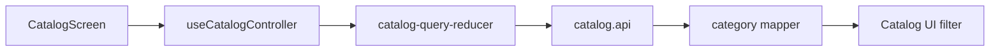

# Mobile Category Selection

**Scenario:** narrow the [catalog](catalog.md) to a category. [SDD](../../../specs/mobile/catalog/002-category-filter/spec.md).

- [CatalogScreen](../../../../libs/mobile/catalog/feature/src/screens/catalog-screen.tsx) receives actions from [useCatalogController](../../../../libs/mobile/catalog/feature/src/hooks/use-catalog-controller.ts); [catalog-query-reducer](../../../../libs/mobile/catalog/feature/src/state/catalog-query-reducer.ts) changes the query and resets pagination to the first page.
- [catalog.api](../../../../libs/mobile/catalog/data-access/src/api/catalog.api.ts) reads categories and products separately, and the [category mapper](../../../../libs/mobile/catalog/data-access/src/mappers/catalog-categories.mapper.ts) validates transport data. The filter UI is in the [catalog UI](../../../../libs/mobile/catalog/ui/src/index.ts). [Categories contract](../../../contracts/catalog/admin-categories.md).

## Architecture



## Code structure

Actual entry points and primary feature files (other files in these directories are omitted):

```text
libs/mobile/catalog/
├── data-access/src/
│   ├── api/catalog.api.ts  # API request
│   └── mappers/catalog-categories.mapper.ts  # API response transformation
├── feature/src/
│   ├── hooks/use-catalog-controller.ts  # screen state and actions
│   ├── screens/catalog-screen.tsx  # feature screen
│   └── state/catalog-query-reducer.ts  # state and data interaction
└── ui/src/index.ts  # library public API
```
