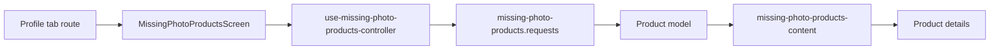

# Mobile Products Without Photos

**Scenario:** view products without available images and open their details. [SDD](../../../specs/mobile/profile/001-products-missing-photos/README.md).

- [(tabs)/profile.tsx](../../../../apps/mobile/src/app/%28tabs%29/profile.tsx) currently connects [MissingPhotoProductsScreen](../../../../libs/mobile/catalog/feature/src/screens/missing-photo-products-screen.tsx); the user profile is not implemented on this route.
- The [controller](../../../../libs/mobile/catalog/feature/src/hooks/use-missing-photo-products-controller.ts) manages loading and actions; [content](../../../../libs/mobile/catalog/feature/src/components/missing-photo-products-content.tsx) reuses catalog UI components.
- The [request](../../../../libs/mobile/catalog/data-access/src/api/missing-photo-products.requests.ts) and mapper convert `GET /api/admin/products/missing-photos` into the product model. [Consumer contract](../../../contracts/catalog/missing-photo-products.md); transition to [details](product-details.md).

## Architecture



## Code structure

Actual entry points and primary feature files (other files in these directories are omitted):

```text
apps/mobile/src/app/
└── (tabs)/profile.tsx  # route entry point

libs/mobile/catalog/
├── data-access/src/api/missing-photo-products.requests.ts  # API request
└── feature/src/
    ├── components/missing-photo-products-content.tsx  # UI component
    ├── hooks/use-missing-photo-products-controller.ts  # screen state and actions
    └── screens/missing-photo-products-screen.tsx  # feature screen
```
