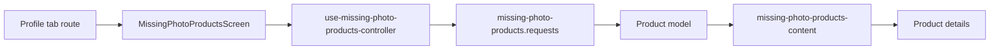

# Товари без фото Mobile

**Сценарій:** перегляд товарів без доступних зображень і перехід до деталей. [SDD](../../../specs/mobile/profile/001-products-missing-photos/README.md).

- [(tabs)/profile.tsx](../../../../apps/mobile/src/app/%28tabs%29/profile.tsx) зараз підключає [MissingPhotoProductsScreen](../../../../libs/mobile/catalog/feature/src/screens/missing-photo-products-screen.tsx); профіль користувача цим маршрутом не реалізовано.
- [Controller](../../../../libs/mobile/catalog/feature/src/hooks/use-missing-photo-products-controller.ts) керує завантаженням та діями; [content](../../../../libs/mobile/catalog/feature/src/components/missing-photo-products-content.tsx) повторно використовує каталогові UI-компоненти.
- [Запит](../../../../libs/mobile/catalog/data-access/src/api/missing-photo-products.requests.ts) і mapper переводять `GET /api/admin/products/missing-photos` у модель товару. [Consumer contract](../../../contracts/catalog/missing-photo-products.md); перехід — до [деталей](product-details.md).

## Схема будови



## Структура в коді

Фактичні точки входу й основні файли фічі (інші файли цих каталогів тут не перелічено):

```text
apps/mobile/src/app/
└── (tabs)/profile.tsx  # точка входу маршруту

libs/mobile/catalog/
├── data-access/src/api/missing-photo-products.requests.ts  # запит до API
└── feature/src/
    ├── components/missing-photo-products-content.tsx  # компонент інтерфейсу
    ├── hooks/use-missing-photo-products-controller.ts  # стан і дії екрана
    └── screens/missing-photo-products-screen.tsx  # екран фічі
```
