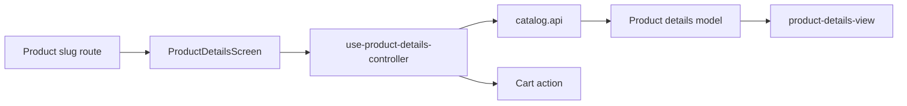

# Деталі товару Mobile

**Сценарій:** перегляд товару й додавання до кошика. [SDD](../../../specs/mobile/catalog/004-product-details/README.md).

- [Route product slug](../../../../apps/mobile/src/app/product/[productSlug].tsx) підключає [ProductDetailsScreen](../../../../libs/mobile/catalog/feature/src/screens/product-details-screen.tsx).
- [Controller](../../../../libs/mobile/catalog/feature/src/hooks/use-product-details-controller.ts) об'єднує завантаження й дію кошика; [UI](../../../../libs/mobile/catalog/ui/src/components/product-details/product-details-view.tsx) показує галерею, характеристики та стани.
- [catalog.api](../../../../libs/mobile/catalog/data-access/src/api/catalog.api.ts), runtime schema і mapper формують [модель деталей](../../../../libs/mobile/catalog/model/src/entities/catalog-product-details.ts). Відкривається з [каталогу](catalog.md) та [товарів без фото](missing-photos.md).

## Схема будови



## Структура в коді

Фактичні точки входу й основні файли фічі (інші файли цих каталогів тут не перелічено):

```text
apps/mobile/src/app/
└── product/[productSlug].tsx  # точка входу маршруту

libs/mobile/catalog/
├── data-access/src/api/catalog.api.ts  # запит до API
├── feature/src/
│   ├── hooks/use-product-details-controller.ts  # стан і дії екрана
│   └── screens/product-details-screen.tsx  # екран фічі
├── model/src/entities/catalog-product-details.ts  # доменна модель
└── ui/src/components/product-details/product-details-view.tsx  # компонент інтерфейсу
```
