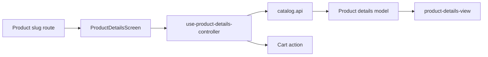

# Mobile Product Details

**Scenario:** view a product and add it to the cart. [SDD](../../../specs/mobile/catalog/004-product-details/README.md).

- The [product slug route](../../../../apps/mobile/src/app/product/[productSlug].tsx) connects [ProductDetailsScreen](../../../../libs/mobile/catalog/feature/src/screens/product-details-screen.tsx).
- The [controller](../../../../libs/mobile/catalog/feature/src/hooks/use-product-details-controller.ts) combines loading and the cart action; the [UI](../../../../libs/mobile/catalog/ui/src/components/product-details/product-details-view.tsx) shows the gallery, specifications, and states.
- [catalog.api](../../../../libs/mobile/catalog/data-access/src/api/catalog.api.ts), the runtime schema, and mapper produce the [details model](../../../../libs/mobile/catalog/model/src/entities/catalog-product-details.ts). Opened from the [catalog](catalog.md) and [products without photos](missing-photos.md).

## Architecture



## Code structure

Actual entry points and primary feature files (other files in these directories are omitted):

```text
apps/mobile/src/app/
└── product/[productSlug].tsx  # route entry point

libs/mobile/catalog/
├── data-access/src/api/catalog.api.ts  # API request
├── feature/src/
│   ├── hooks/use-product-details-controller.ts  # screen state and actions
│   └── screens/product-details-screen.tsx  # feature screen
├── model/src/entities/catalog-product-details.ts  # domain model
└── ui/src/components/product-details/product-details-view.tsx  # UI component
```

## Tests

Spec files sit next to the code in each project. Focused runs:

- `apps/mobile` (5 spec files): `npx nx run mobile:test`
- `libs/mobile/catalog/data-access` (9 spec files): `npx nx run mobile-catalog-data-access:test`
- `libs/mobile/catalog/feature` (7 spec files): `npx nx run mobile-catalog-feature:test`
- `libs/mobile/catalog/model` (5 spec files): `npx nx run mobile-catalog-model:test`
- `libs/mobile/catalog/ui` (9 spec files): `npx nx run mobile-catalog-ui:test`
