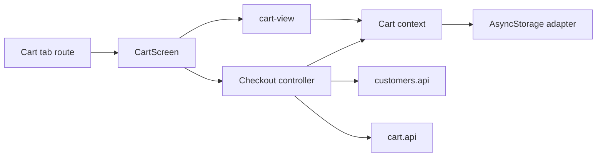

# Mobile Cart and Checkout

**Scenario:** a manager edits the local cart, selects a customer, and creates a Sales order. [SDD and device QA boundaries](../../../specs/mobile/cart/001-manager-cart-checkout/README.md).

- [(tabs)/cart.tsx](../../../../apps/mobile/src/app/%28tabs%29/cart.tsx) connects [CartScreen](../../../../libs/mobile/cart/feature/src/screens/cart-screen.tsx) and the [cart UI](../../../../libs/mobile/cart/ui/src/lib/cart-view.tsx).
- [Cart context](../../../../libs/mobile/cart/data-access/src/lib/cart-context.tsx) and the [AsyncStorage adapter](../../../../libs/mobile/cart/data-access/src/lib/cart-storage.ts) store line items; the [cart model](../../../../libs/mobile/cart/model/src/lib/cart.ts) defines operations.
- The [checkout controller](../../../../libs/mobile/cart/feature/src/hooks/use-cart-checkout-controller.ts) validates the form, reads customers, creates an idempotency key, and calls [cart.api](../../../../libs/mobile/cart/data-access/src/lib/cart.api.ts). Success clears the cart; an error keeps it for retry.
- Contracts: [customers.api](../../../../libs/mobile/customers/data-access/src/api/customers.api.ts) and [manager order](../../../contracts/sales/manager-order.md). The created order can then be read in [order history](orders.md).

## Architecture



## Code structure

Actual entry points and primary feature files (other files in these directories are omitted):

```text
apps/mobile/src/app/
└── (tabs)/cart.tsx  # route entry point

libs/mobile/cart/
├── data-access/src/lib/
│   ├── cart-context.tsx  # feature implementation
│   ├── cart-storage.ts  # feature implementation
│   └── cart.api.ts  # API request
├── feature/src/
│   ├── hooks/use-cart-checkout-controller.ts  # screen state and actions
│   └── screens/cart-screen.tsx  # feature screen
├── model/src/lib/cart.ts  # domain model
└── ui/src/lib/cart-view.tsx  # UI component

libs/mobile/customers/
└── data-access/src/api/customers.api.ts  # API request
```
