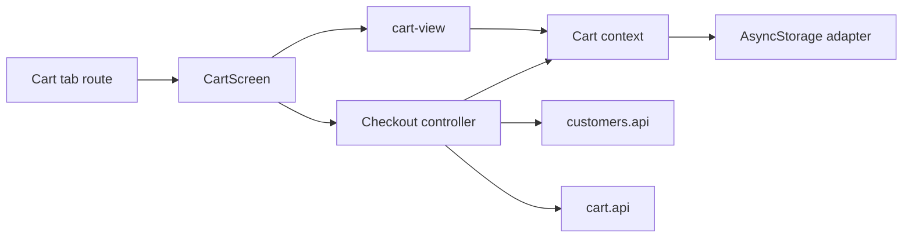

# Кошик і оформлення Mobile

**Сценарій:** менеджер редагує локальний кошик, вибирає клієнта та створює Sales-замовлення. [SDD і межі device QA](../../../specs/mobile/cart/001-manager-cart-checkout/README.md).

- [(tabs)/cart.tsx](../../../../apps/mobile/src/app/%28tabs%29/cart.tsx) підключає [CartScreen](../../../../libs/mobile/cart/feature/src/screens/cart-screen.tsx) і [UI кошика](../../../../libs/mobile/cart/ui/src/lib/cart-view.tsx).
- [Cart context](../../../../libs/mobile/cart/data-access/src/lib/cart-context.tsx) і [AsyncStorage adapter](../../../../libs/mobile/cart/data-access/src/lib/cart-storage.ts) зберігають рядки; [cart model](../../../../libs/mobile/cart/model/src/lib/cart.ts) визначає операції.
- [Checkout controller](../../../../libs/mobile/cart/feature/src/hooks/use-cart-checkout-controller.ts) валідує форму, читає клієнтів, створює idempotency key та викликає [cart.api](../../../../libs/mobile/cart/data-access/src/lib/cart.api.ts). Успіх очищає кошик; помилка залишає його для повтору.
- Контракти: [customers.api](../../../../libs/mobile/customers/data-access/src/api/customers.api.ts) і [manager order](../../../contracts/sales/manager-order.md). Створене замовлення потім читає [історія](orders.md).

## Схема будови



## Структура в коді

Фактичні точки входу й основні файли фічі (інші файли цих каталогів тут не перелічено):

```text
apps/mobile/src/app/
└── (tabs)/cart.tsx  # точка входу маршруту

libs/mobile/cart/
├── data-access/src/lib/
│   ├── cart-context.tsx  # реалізація фічі
│   ├── cart-storage.ts  # реалізація фічі
│   └── cart.api.ts  # запит до API
├── feature/src/
│   ├── hooks/use-cart-checkout-controller.ts  # стан і дії екрана
│   └── screens/cart-screen.tsx  # екран фічі
├── model/src/lib/cart.ts  # доменна модель
└── ui/src/lib/cart-view.tsx  # компонент інтерфейсу

libs/mobile/customers/
└── data-access/src/api/customers.api.ts  # запит до API
```
