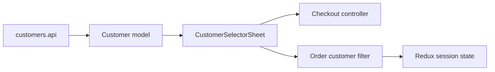

# Вибір клієнта Mobile

**Сценарій:** спільний пошук і вибір контрагента для [checkout](cart.md) та [фільтра замовлень](orders.md); окремого маршруту немає.

- [customers.api](../../../../libs/mobile/customers/data-access/src/api/customers.api.ts) читає `GET /api/admin/customers`, runtime contract і mapper створюють [Customer model](../../../../libs/mobile/customers/model/src/lib/customer.ts).
- [CustomerSelectorSheet](../../../../libs/mobile/customers/ui/src/lib/customer-selector-sheet.tsx) і список відображають вибір; кошик тримає вибраного клієнта у формі [checkout controller](../../../../libs/mobile/cart/feature/src/hooks/use-cart-checkout-controller.ts), замовлення — у [filter hook](../../../../libs/mobile/orders/feature/src/hooks/use-order-customer-filter.ts) та Redux session state.

## Схема будови



## Структура в коді

Фактичні точки входу й основні файли фічі (інші файли цих каталогів тут не перелічено):

```text
libs/mobile/cart/
└── feature/src/hooks/use-cart-checkout-controller.ts  # стан і дії екрана

libs/mobile/customers/
├── data-access/src/api/customers.api.ts  # запит до API
├── model/src/lib/customer.ts  # доменна модель
└── ui/src/lib/customer-selector-sheet.tsx  # компонент інтерфейсу

libs/mobile/orders/
└── feature/src/hooks/use-order-customer-filter.ts  # стан і дії екрана
```
