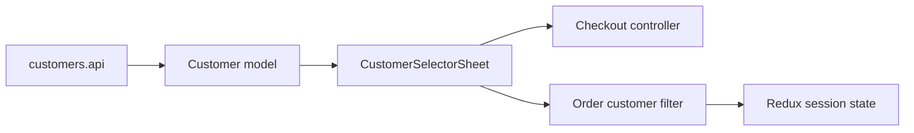

# Mobile Customer Selection

**Scenario:** shared customer search and selection for [checkout](cart.md) and [order filtering](orders.md); there is no separate route.

- [customers.api](../../../../libs/mobile/customers/data-access/src/api/customers.api.ts) reads `GET /api/admin/customers`; runtime contract and mapper produce the [Customer model](../../../../libs/mobile/customers/model/src/lib/customer.ts).
- [CustomerSelectorSheet](../../../../libs/mobile/customers/ui/src/components/selector/customer-selector-sheet.tsx) and the list render the selection. The cart keeps the selected customer in the [checkout controller](../../../../libs/mobile/cart/feature/src/hooks/use-cart-checkout-controller.ts) form; orders keep it in the [filter hook](../../../../libs/mobile/orders/feature/src/hooks/use-order-customer-filter.ts) and Redux session state.

## Architecture



## Code structure

Actual entry points and primary feature files (other files in these directories are omitted):

```text
libs/mobile/cart/
└── feature/src/hooks/use-cart-checkout-controller.ts  # screen state and actions

libs/mobile/customers/
├── data-access/src/api/customers.api.ts  # API request
├── model/src/lib/customer.ts  # domain model
└── ui/src/
    ├── components/selector/customer-selector-sheet.tsx  # UI component
    └── states/customer-selector-state.tsx  # loading, error, empty

libs/mobile/orders/
└── feature/src/hooks/use-order-customer-filter.ts  # screen state and actions
```

## Tests

Spec files sit next to the code in each project. Focused runs:

- `libs/mobile/cart/data-access` (2 spec files): `npx nx run mobile-cart-data-access:test`
- `libs/mobile/cart/feature` (4 spec files): `npx nx run mobile-cart-feature:test`
- `libs/mobile/cart/model` (2 spec files): `npx nx run mobile-cart-model:test`
- `libs/mobile/cart/ui` (2 spec files): `npx nx run mobile-cart-ui:test`
- `libs/mobile/customers/data-access` (2 spec files): `npx nx run mobile-customers-data-access:test`
- `libs/mobile/customers/model` (1 spec files): `npx nx run mobile-customers-model:test`
- `libs/mobile/customers/ui` (1 spec files): `npx nx run mobile-customers-ui:test`
- `libs/mobile/orders/data-access` (4 spec files): `npx nx run mobile-orders-data-access:test`
- `libs/mobile/orders/feature` (3 spec files): `npx nx run mobile-orders-feature:test`
- `libs/mobile/orders/model` (2 spec files): `npx nx run mobile-orders-model:test`
- `libs/mobile/orders/ui` (3 spec files): `npx nx run mobile-orders-ui:test`
