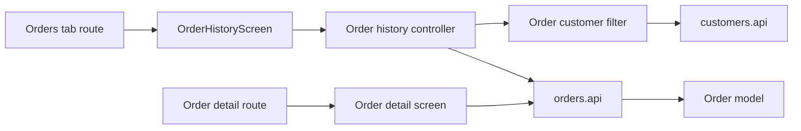

# Історія та деталі замовлень Mobile

**Сценарій:** список замовлень із фільтром за клієнтом та екран деталей. [SDD](../../../specs/mobile/orders/001-order-history/README.md).

- [(tabs)/orders.tsx](../../../../apps/mobile/src/app/%28tabs%29/orders.tsx) підключає [OrderHistoryScreen](../../../../libs/mobile/orders/feature/src/screens/order-history-screen.tsx); [route деталей](../../../../apps/mobile/src/app/orders/[orderId].tsx) підключає окремий екран.
- [Controller](../../../../libs/mobile/orders/feature/src/hooks/use-order-history-controller.ts) поєднує сторінки з [фільтром клієнта](../../../../libs/mobile/orders/feature/src/hooks/use-order-customer-filter.ts); вибір клієнта зберігається в Redux session state.
- [orders.api](../../../../libs/mobile/orders/data-access/src/api/orders.api.ts) читає список і деталі, а схеми й мапери створюють [order model](../../../../libs/mobile/orders/model/src/index.ts). Picker читає [customers.api](../../../../libs/mobile/customers/data-access/src/api/customers.api.ts). Контракт: [manager order](../../../contracts/sales/manager-order.md).

## Схема будови



## Структура в коді

Фактичні точки входу й основні файли фічі (інші файли цих каталогів тут не перелічено):

```text
apps/mobile/src/app/
├── (tabs)/orders.tsx  # точка входу маршруту
└── orders/[orderId].tsx  # точка входу маршруту

libs/mobile/customers/
└── data-access/src/api/customers.api.ts  # запит до API

libs/mobile/orders/
├── data-access/src/api/orders.api.ts  # запит до API
├── feature/src/
│   ├── hooks/
│   │   ├── use-order-customer-filter.ts  # стан і дії екрана
│   │   └── use-order-history-controller.ts  # стан і дії екрана
│   └── screens/order-history-screen.tsx  # екран фічі
└── model/src/index.ts  # публічний API бібліотеки
```
