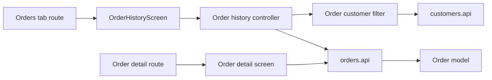

# Mobile order history and details

**Scenario:** order list filtered by customer and an order details screen. [SDD](../../../specs/mobile/orders/001-order-history/README.md).

- [(tabs)/orders.tsx](../../../../apps/mobile/src/app/%28tabs%29/orders.tsx) connects [OrderHistoryScreen](../../../../libs/mobile/orders/feature/src/screens/order-history-screen.tsx); the [details route](../../../../apps/mobile/src/app/orders/[orderId].tsx) connects a separate screen.
- The [controller](../../../../libs/mobile/orders/feature/src/hooks/use-order-history-controller.ts) combines pages with the [customer filter](../../../../libs/mobile/orders/feature/src/hooks/use-order-customer-filter.ts); the selected customer is stored in Redux session state.
- [orders.api](../../../../libs/mobile/orders/data-access/src/api/orders.api.ts) reads lists and details, while schemas and mappers build the [order model](../../../../libs/mobile/orders/model/src/index.ts). The picker reads [customers.api](../../../../libs/mobile/customers/data-access/src/api/customers.api.ts). Contract: [manager order](../../../contracts/sales/manager-order.md).

## Structure diagram



## Code structure

Actual entry points and main feature files (other files in these directories are omitted):

```text
apps/mobile/src/app/
├── (tabs)/orders.tsx  # route entry point
└── orders/[orderId].tsx  # route entry point

libs/mobile/customers/
└── data-access/src/api/customers.api.ts  # API request

libs/mobile/orders/
├── data-access/src/api/orders.api.ts  # API request
├── feature/src/
│   ├── hooks/
│   │   ├── use-order-customer-filter.ts  # screen state and actions
│   │   └── use-order-history-controller.ts  # screen state and actions
│   └── screens/order-history-screen.tsx  # feature screen
├── model/src/index.ts  # library public API
└── ui/src/
    ├── components/history/  # order rows, bento summary, list, footer
    ├── components/detail/  # detail view, summary, products, metadata
    ├── components/status/  # status pill and icon
    └── states/  # loading, empty, error
```

## Tests

Spec files sit next to the code in each project. Focused runs:

- `apps/mobile` (5 spec files): `npx nx run mobile:test`
- `libs/mobile/customers/data-access` (2 spec files): `npx nx run mobile-customers-data-access:test`
- `libs/mobile/customers/model` (1 spec files): `npx nx run mobile-customers-model:test`
- `libs/mobile/customers/ui` (1 spec files): `npx nx run mobile-customers-ui:test`
- `libs/mobile/orders/data-access` (4 spec files): `npx nx run mobile-orders-data-access:test`
- `libs/mobile/orders/feature` (3 spec files): `npx nx run mobile-orders-feature:test`
- `libs/mobile/orders/model` (2 spec files): `npx nx run mobile-orders-model:test`
- `libs/mobile/orders/ui` (3 spec files): `npx nx run mobile-orders-ui:test`
