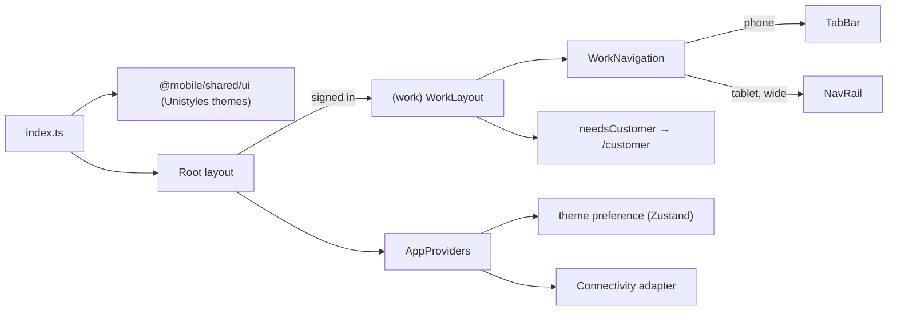

# Mobile shell and navigation

**Scenario:** Kedr Manager starts, shows the five sections and keeps the ones that need a customer locked. [SDD](../../specs/mobile/manager/001-manager-app/README.md) (R-002, R-017; SC-003, SC-024). Look: [design system «Офіс»](../../standards/mobile/design-system.md).

- The [app entry](../../../apps/mobile/index.ts) imports `@mobile/shared/ui` first, which registers the «Офіс» light and dark themes and the `phone` / `tablet` / `wide` breakpoints with Unistyles, and then starts Expo Router. The [Babel config](../../../apps/mobile/babel.config.js) runs the Unistyles plugin in the app; Jest uses the Unistyles mocks.
- The [root layout](../../../apps/mobile/src/app/_layout.tsx) loads Golos Text behind the splash screen, wraps everything in [AppProviders](../../../libs/mobile/core/shell/src/providers/app-providers.tsx) (gestures, safe areas, bottom sheets, navigation colors, network state, orientation) and splits routes by the session (see [sign-in](auth.md)).
- [WorkLayout](../../../libs/mobile/core/shell/src/navigation/work-layout.tsx) is the signed-in area `(work)`: tabs Клієнт, Товари, Розрахунок, Замовлення, Кабінет from [work-tabs](../../../libs/mobile/core/shell/src/navigation/work-tabs.ts). [WorkNavigation](../../../libs/mobile/core/shell/src/navigation/work-navigation.tsx) draws the [TabBar](../../../libs/mobile/core/shell/src/navigation/tab-bar.tsx) on phones and the 76 dp [NavRail](../../../libs/mobile/core/shell/src/navigation/nav-rail.tsx) on tablets.
- `WorkLayout` takes a `statusStrip` slot: the app passes the [sync status strip](sync.md), drawn above the phone tab bar or under the rail items, so the shell does not depend on the sync domain.
- Customer gate: without a customer, «Товари», «Розрахунок» and «Замовлення» show a lock and do not open, and a link into them lands on `/customer`. Until the customer stage the [work layout route](../../../apps/mobile/src/app/%28work%29/_layout.tsx) passes `hasCustomer={false}`.
- Phones stay in portrait, tablets turn freely ([orientation policy](../../../libs/mobile/core/shell/src/providers/orientation-policy.ts)). The theme choice «Як у системі / Світла / Темна» is a persisted Zustand store ([theme-preference-store](../../../libs/mobile/core/shell/src/theme/theme-preference-store.ts)). The shell picks the theme itself ([use-theme-name](../../../libs/mobile/core/shell/src/theme/use-theme-name.ts)), sets it in Unistyles and, on a change, mounts the screens again and reopens the open one ([theme-repaint](../../../libs/mobile/core/shell/src/providers/theme-repaint.tsx)): on a device Unistyles did not repaint views that stayed mounted.
- [WorkScreen](../../../libs/mobile/core/shell/src/layout/work-screen.tsx) is the screen frame; [CustomerBar](../../../libs/mobile/core/shell/src/customer/customer-bar.tsx) tops products, calculation and orders. Customer choice and products are live ([customers](customers.md), [products](catalog.md)); calculation and orders are placeholders until their stages.

## Structure diagram



## Code structure

```text
apps/mobile/
├── index.ts  # Unistyles first, then Expo Router
├── babel.config.js  # Unistyles Babel plugin
└── src/app/
    ├── _layout.tsx  # fonts, providers, session split
    ├── index.tsx  # → /customer
    └── (work)/
        ├── _layout.tsx  # WorkLayout with the customer gate
        ├── customer/, products/, orders/  # section stacks (orders is a placeholder)
        ├── calculation.tsx  # placeholder
        └── cabinet.tsx  # account, theme, quick unlock, sign-out

libs/mobile/core/shell/src/
├── navigation/  # work-tabs, work-layout, work-navigation, tab-bar, nav-rail, work-nav-item
├── providers/  # app-providers, connectivity-context, orientation-policy
├── theme/  # theme-preference-store, theme-preference-control, use-theme-name, navigation-theme
├── layout/work-screen.tsx  # screen frame
└── customer/customer-bar.tsx  # chosen customer bar

libs/mobile/shared/ui/src/
├── theme/  # palette, typography, shape, breakpoints, motion, themes, unistyles
├── components/{text,controls,inputs,feedback,surfaces}/  # «Офіс» components
├── hooks/use-breakpoint.ts
└── testing/  # Unistyles and icon mocks for Jest
```

## Tests

- `apps/mobile` (1 spec file, routes and gate): `npx nx run mobile:test`
- `libs/mobile/core/shell` (4 spec files): `npx nx run shell:test`
- `libs/mobile/shared/ui` (2 spec files: tokens and contrast, components): `npx nx run mobile-shared-ui:test`
- `libs/mobile/core/connectivity` (1 spec file): `npx nx run mobile-core-connectivity:test`
