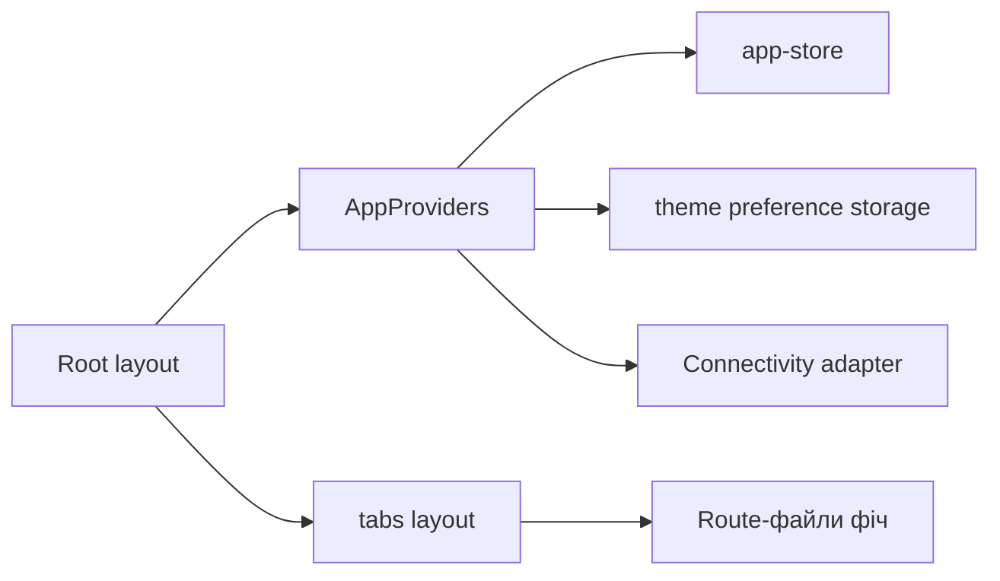

# Оболонка й навігація Mobile

**Сценарій:** запуск застосунку, вкладки, тема й мережевий стан. [SDD](../../specs/mobile/shell/001-app-shell-navigation/spec.md).

- [Root layout](../../../apps/mobile/src/app/_layout.tsx) і [tabs layout](../../../apps/mobile/src/app/%28tabs%29/_layout.tsx) задають Expo Router структуру; React Native Paper відображає навігацію.
- [AppProviders](../../../libs/mobile/core/shell/src/providers/app-providers.tsx), [app-store](../../../libs/mobile/core/shell/src/state/app-store.ts) і [theme preference storage](../../../libs/mobile/core/shell/src/storage/theme-preference-storage.ts) забезпечують спільний стан. [Connectivity adapter](../../../libs/mobile/core/connectivity/src/lib/connectivity-adapter.ts) відстежує мережу.
- Route-файли залишаються тонкими; бізнес-логіка та API належать доменним бібліотекам. Початкова вкладка зараз placeholder.

## Схема будови



## Структура в коді

Фактичні точки входу й основні файли фічі (інші файли цих каталогів тут не перелічено):

```text
apps/mobile/src/app/
├── (tabs)/_layout.tsx  # точка входу маршруту
└── _layout.tsx  # точка входу маршруту

libs/mobile/core/connectivity/
└── src/lib/connectivity-adapter.ts  # реалізація фічі

libs/mobile/core/shell/
└── src/
    ├── providers/app-providers.tsx  # реалізація фічі
    ├── state/app-store.ts  # стан і взаємодія з даними
    └── storage/theme-preference-storage.ts  # локальне збереження
```
