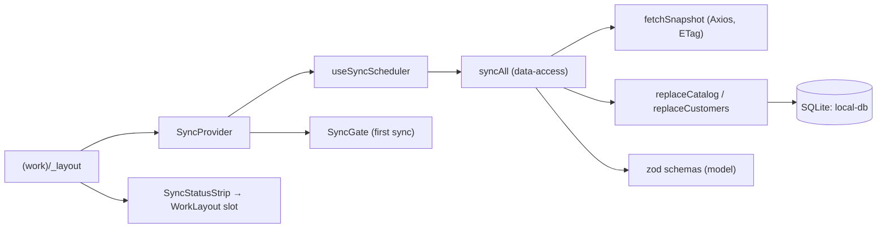

# Mobile offline data and sync

**Scenario:** after sign-in Kedr Manager downloads the catalog and the customers once, keeps them on the device and works with them without a network; later syncs run in the background. [SDD](../../specs/mobile/manager/001-manager-app/README.md) (R-014, R-015; SC-020). Backend: KedrStore spec `platform/004-mobile-offline-sync`, contract [catalog](../../contracts/openapi/catalog/mobile-sync.openapi.yaml) and [customers](../../contracts/openapi/sales/mobile-sync.openapi.yaml) snapshots.

- [Local database](../../../libs/mobile/core/local-db/src/database/local-database.ts): one SQLite file on `expo-sqlite`, typed with Drizzle. Tables: `categories`, `price_types`, `products` (photos as a JSON list, main first), `product_prices` (UAH in kopecks), `customers`, `customer_category_price_types`, `sync_state` (ETag and time per snapshot). [Migrations](../../../libs/mobile/core/local-db/src/migrations/migrations.ts) are an ordered SQL list applied by `PRAGMA user_version`; sign-out empties every table.
- [Snapshot client](../../../libs/mobile/sync/data-access/src/client/snapshot-client.ts) asks `GET /api/mobile/sync/{catalog,customers}` with the stored `If-None-Match`; `304` keeps the data. The [sync runner](../../../libs/mobile/sync/data-access/src/runner/sync-runner.ts) validates a new body with the zod schemas of [`@mobile/sync/model`](../../../libs/mobile/sync/model/src/index.ts) and swaps the tables in one transaction, so screens see either the old or the new data. A broken snapshot keeps the old data; `401`/`403` stops the run.
- [SyncProvider](../../../libs/mobile/sync/feature/src/components/sync-provider.tsx) wraps the working area in `(work)/_layout.tsx`. It takes the database from `LocalDatabaseProvider` of `@mobile/core/local-db`; every table replace calls `markLocalDataChanged()`, so screens that read with `useLocalDataVersion()` re-read after a sync. Its [scheduler](../../../libs/mobile/sync/feature/src/hooks/use-sync-scheduler.ts) syncs once a day (checked on start, on network return and every hour) and at once on request. Until the first sync is stored, [SyncGate](../../../libs/mobile/sync/feature/src/components/sync-gate.tsx) shows progress, «Немає мережі» or a retry; afterwards it never blocks.
- [SyncStatusStrip](../../../libs/mobile/sync/feature/src/components/sync-status-strip.tsx) shows «Без мережі · дані від 14:05» above the phone tab bar (or under the tablet rail items) and «Оновлюємо дані…» while old data is being refreshed. The shell only gives it a slot (`statusStrip` of `WorkLayout`).
- Sign-out in the cabinet calls `clearDeviceData()`, which empties the database and the sync status.

## Structure diagram



## Code structure

```text
libs/mobile/core/local-db/src/
├── schema/{catalog,customers,sync-state}.ts  # Drizzle tables
├── migrations/migrations.ts  # ordered SQL, user_version
├── database/{local-database,open-local-database}.ts  # migrate, wipe; expo-sqlite connection
└── testing.ts  # better-sqlite3 database for Jest (@mobile/core/local-db/testing)
libs/mobile/sync/
├── model/src/{snapshots,status}/  # zod schemas, kopecks, resources, staleness
├── data-access/src/{client,store,runner}/  # HTTP with ETag, table replace, syncAll
└── feature/src/{components,hooks,state}/  # provider, gate, strip, scheduler, status store, clearDeviceData
```

## Tests

- `npx nx run mobile-core-local-db:test` — migrations match the Drizzle tables, wipe.
- `npx nx run mobile-sync-model:test`, `npx nx run mobile-sync-data-access:test` — schemas, ETag/304, transactional replace, failures.
- `npx nx run mobile-sync-feature:test` — first sync, offline without data, retry, offline with data, strip.

Jest runs the local database on `better-sqlite3` in memory with the same Drizzle API as `expo-sqlite`; the device driver itself is checked on a device in stage 8.
