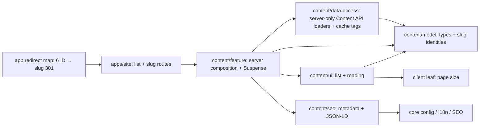

# Статті: список і читання

**Routes:** `/{locale}/articles`, `/{locale}/articles/{slug}`; locale = uk/ru. Старі `/{locale}/articles/{1..6}` мають 301 до slug. [SDD](../../specs/site/content/001-articles/README.md).

Список використовує погоджений концепт, існуючі shell/Onest/теми та сітку 1/2/3 колонки. Видимого label перед пошуком немає; поле й форма мають доступні назви. Native GET шукає назву або повний текст у всьому локалізованому наборі. Поки статей менше 20 і відвідувач нічого не обрав, сторінка показує лише картки: пошук, розмір сторінки й пагінація з'являються від 20 статей або після будь-якого вибору ([articles-tools.ts](../../../libs/site/content/model/src/lib/mappers/articles-tools.ts)). Ліміт 10 за замовчуванням, вибір 10/20/50; новий q/size скидає page, сторінкові посилання зберігають вибір і ведуть до #articles-results під sticky header. Порожня видача має очистку, непорожня одна сторінка зберігає pager із disabled краями. Desktop — номери; mobile — N / total.

Query owner: content/model, `q`, `pageSize`, `page`. Defaults omitted, input bounded, filter before paging, out-of-range page temporarily redirects to last available normalized URL. Unknown slug is notFound in page and metadata. Detail is server HTML with full source paragraphs, publication date, cover, breadcrumb, a closing «Підберіть фурнітуру» block linking to the catalog and «Співпраця» (links passed by the feature), and the back link; no nested main. The list title in search results is «Статті про дверну фурнітуру» / «Статьи о дверной фурнитуре»; the breadcrumb stays «Статті».

## Джерело та межі

Статті зберігаються в модулі Content KedrStore (схема `content`); шість матеріалів старого storefront перенесено туди міграцією разом з обкладинками. Сайт читає публічний API `GET /api/content/{lang}/articles` і `/{lang}/articles/{slug}` у server-only [article-loaders.ts](../../../libs/site/content/data-access/src/lib/articles/article-loaders.ts) з тегами `content`, `content:articles`, `article:{slug}` і життям 5/10 хв (збій — 1 хв). Обкладинка — `coverUrl` з CDN (`images-kedr.cdn.express/articles/…`); у шести старих статей, поки обкладинку не замінять, — абсолютний URL API (`/api/content/articles/{id}/cover?v=…`, immutable). Обидва хости дозволені в `next.config.ts` images. Пошук у списку йде по заголовку й короткому опису: список API не віддає тексти. Недоступний API дає 500, невідомий slug — 404; при збої під час build пререндериться placeholder-slug, що відповідає 404. Статті редагують в адмінці ([Admin Articles](../admin/articles.md)).

List metadata/BreadcrumbList, detail metadata/Article graph делегують core SEO; actual q і nondefault size noindex, search має self canonical без hreflang; звичайні сторінки та detail — self canonical/UK-RU/x-default. Production gate збережений. Sitemap додає список і кожну опубліковану статтю обома мовами з API ([article-sitemap.ts](../../../libs/site/content/feature/src/lib/sitemap/article-sitemap.ts)), без query/ID/вигаданих дат зміни.

## Structure diagram



## Code structure

```text
apps/site/
  article-redirects.ts                       # deployment redirect map
  next.config.ts                            # includes the six 301 rules
  src/app/[locale]/(content)/articles/
    page.tsx                                # thin list + metadata
    [slug]/page.tsx                          # thin detail + parent-locale SSG
libs/site/content/
  model/src/lib/articles/
    article-types.ts                        # typed Article/query/result and defaults
    articles-query.ts                       # query normalization and href
    article-routes.ts                       # list path, detail href
    article-text.ts                         # plain text of body HTML
    article-page-window.ts                  # bounded pager window
    articles-listing.ts                      # full-source filter, page/clamp/range
    articles-dictionary.ts                  # UK/RU presentation strings
    articles.spec.ts                        # query/listing characterization
    article-routes.spec.ts                  # escaped detail path assertion
    article-page-window.spec.ts             # bounded page-window assertions
  data-access/src/lib/articles/
    article-cache.ts                        # cache tags and lifetimes
    article.mapper.ts                       # API DTO → Article, CDN or absolute legacy cover URL
    article-loaders.ts                      # getArticles/getArticle (ok | not-found | unavailable)
    article-loaders.spec.ts                 # mapping, 404 and failure handling
  ui/src/lib/articles/
    articles-header.tsx                     # static breadcrumbs/H1/intro
    articles-content.tsx                    # server list body
    articles-search-form.tsx                # GET search + sr-only label
    articles-page-size-select.tsx           # only client leaf
    articles-pagination.tsx                 # range + links/disabled boundaries
    article-card.tsx                        # one card/one link
    article-cover.tsx                       # 16:9 image/fallback
    article-content.tsx                     # full article reading (sanitized server HTML)
    articles-loading.tsx                    # Suspense status
    articles-content.spec.tsx               # UI/interaction/locale tests
  seo/src/lib/articles/
    article-seo-types.ts                     # plain SEO input, no model import
    articles-seo-copy.ts                     # localized SEO text
    articles-metadata.ts                     # list/detail metadata
    articles-json-ld.ts                      # breadcrumbs + Article graph
    *.spec.ts                               # metadata/schema tests
  feature/src/lib/
    articles/articles-page.tsx              # request query under Suspense
    articles/article-page.tsx               # detail / metadata / static params
    articles/articles-page.spec.tsx         # server composition with mocked loaders
    articles/article-sitemap.ts             # published articles for the sitemap
    content-sitemap.ts                      # static content pages
    content-sitemap.spec.ts                 # sitemap integration
```

## Tests

Focused commands (cwd repository root, NX_DAEMON=false):

- `node node_modules/nx/dist/bin/nx.js run site-content-model:vite:test -- --run src/lib/articles/articles.spec.ts src/lib/articles/article-routes.spec.ts src/lib/articles/article-page-window.spec.ts` — 18 tests.
- `node node_modules/nx/dist/bin/nx.js run site-content-data-access:vite:test -- --run` — 7 tests.
- `node node_modules/nx/dist/bin/nx.js run site-content-ui:vite:test -- --run src/lib/articles/articles-content.spec.tsx` — 13 tests.
- `node node_modules/nx/dist/bin/nx.js run site-content-seo:vite:test -- --run src/lib/articles/articles-metadata.spec.ts src/lib/articles/articles-json-ld.spec.ts` — 17 new tests; touched SEO regression 37 tests.
- `node node_modules/nx/dist/bin/nx.js run site-content-feature:vite:test -- --run src/lib/articles/articles-page.spec.tsx src/lib/content-sitemap.spec.ts` — 13 tests in the current shared sitemap state.
- `node node_modules/nx/dist/bin/nx.js run site:typecheck` — route/server-client source boundary.

[Exact evidence and limits](../../specs/site/content/001-articles/verification/results.md). Browser, production build, E2E and HTTP runtime have not been run; source/tests do not establish deployment behavior.

## Function audit (2026-11-03)

[web-frontend function audit](../../specs/site/content/001-articles/code-audit/audit.md) completed phases00–06. AF-001/AF-002 verified: query/routes/page-window responsibilities separated with stable public API; source-regression guard saved. Current refactor checks: 51 focused tests passed, site source/model test types and scoped lint passed.

Reproduce source/boundary/redirect checks: `node --experimental-strip-types docs/specs/site/content/001-articles/verification/source-invariants.mjs`. This validates source contracts, not deployed HTTP responses.
