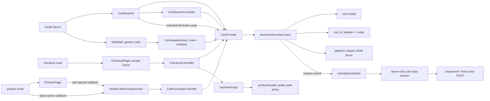

# Site: корзина и оформление заказа

**Статус:** implemented locally 2026-11-04; automated/source verified; architecture audit AF-003–006 verified. Build, HTTP, browser и live order не проверялись. Это локальная реализация, без подтверждения публикации.

**Маршрут:** `/{locale}/checkout`, локали `uk` и `ru`. [Маршрут оформления](../../../apps/site/src/app/[locale]/checkout/page.tsx) делегирует представление `CheckoutPage`, metadata — `buildCheckoutMetadata`. Отдельного маршрута корзины нет: панель открывают действия основной и компактной шапки, подключённые через generic slots в [locale layout](../../../apps/site/src/app/[locale]/layout.tsx).

## Поведение и владельцы

- [CartRuntime](../../../libs/site/cart/feature/src/lib/runtime/cart-runtime.tsx) собирает один provider, одну панель и серверную action вокруг содержимого SiteShell. [CartProvider](../../../libs/site/cart/feature/src/lib/runtime/cart-provider.tsx) подписывает потребителей на один browser/document owner; мягкая смена языка, темы и remount сохраняют контакты и ожидающую отправку. Серверный снимок нейтрален; storage читается после гидрации.
- Чистая модель объединяет строки по идентификатору, сохраняя существующий snapshot, считает единицы и стоимость товаров. Допуск покупки требует наличия по текущей product policy и положительной конечной цены. Количество — целое 1…1000, удаление отдельное; переполнение не обрезается. Это заменяет старый UI-максимум 99.
- [Codec](../../../libs/site/cart/model/src/lib/persistence/cart-persistence.ts) и [storage adapter](../../../libs/site/cart/feature/src/lib/storage/cart-storage.ts) поддерживают старый `cart_v1`. Частичное восстановление требует явного решения и не перезаписывает источник при чтении. Сохраняются только строки корзины; контакты и receipt остаются в памяти. Полная перезагрузка сбрасывает контакты. Нет фонового обновления цены/наличия, резерва или синхронизации вкладок.
- Анонимный быстрый заказ требует только имени 3…30 символов после trim и полного телефона `+38 (0XX) XXX-XX-XX`. Во время отправки строки и контакты заблокированы. [Server Function](../../../libs/site/cart/feature/src/lib/actions/submit-quick-order.ts) проверяет неизвестную команду и вызывает server-only data-access; [общий транспорт](../../../libs/site/shared/api-client/src/lib/site-order-api.ts) выполняет только фиксированный anonymous `POST /api/orders`, `no-store`, без переноса сессии и автоматических повторов.
- Подтверждение принимается только с корректным UUID: показываются фактический номер и принятая сумма товаров, корзина/контакты очищаются. Ошибка локальной очистки не отменяет receipt. Валидация `400` и конфликт `409` сохраняют ввод; сеть, таймаут, `5xx` и некорректный успешный ответ дают неопределённый результат с предложением уточнить статус у менеджера, без автоматического повтора.
- UI поддерживает UK/RU и светлую/тёмную тему. [Сетка оформления](../../../libs/site/cart/ui/src/lib/checkout/checkout-view.module.css) переключается на две колонки при ширине контейнера checkout от 720 px; меньший контейнер использует одну колонку. Доставка вне суммы товаров, доставку и оплату согласует менеджер. Панель использует модальный focus/keyboard flow и возврат фокуса.

Списки категорий и поиска показывают «У кошик» на карточке и в строке таблицы: [category route](../../../apps/site/src/app/[locale]/catalog/[slug]/page.tsx) и [search route](../../../apps/site/src/app/[locale]/search/page.tsx) передают `renderCartQuickAddAction`, catalog feature строит структурный descriptor ([listing-purchase.ts](../../../libs/site/catalog/feature/src/lib/listing/listing-purchase.ts)), а [CartQuickAddController](../../../libs/site/cart/feature/src/lib/purchase/cart-quick-add-controller.tsx) добавляет одну единицу и открывает панель корзины. Тот же адаптер даёт кнопку для мобильной панели покупки на странице товара. На странице модели [renderCartBulkAddAction](../../../libs/site/cart/feature/src/lib/purchase/render-cart-purchase-action.tsx) рисует таблицу всех вариантов ([CartBulkAddTable](../../../libs/site/cart/ui/src/lib/purchase/cart-bulk-add-table.tsx)): количество в каждой строке и «Додати вибране в кошик», которое добавляет все строки с количеством и открывает панель корзины ([spec site/product/002](../../specs/site/product/002-site-models/README.md) D-05). Номер заказа на подтверждении показан коротко: первые 8 символов UUID; менеджер в Telegram видит его вместе с полным UUID. Скрытое поле-ловушка отбрасывает отправки ботов, а backend ограничивает поток быстрых заказов: 60 за 10 минут на вызывающий адрес (сайт отправляет заказы со своего сервера, поэтому это общий предел от флуда, а не на покупателя).

[Product route](../../../apps/site/src/app/[locale]/product/[slug]/page.tsx) передаёт `renderCartPurchaseAction` как серверный callback в ProductPage. Товар формирует свой нормализованный descriptor, callback возвращает узел покупки. Product feature не импортирует cart feature, cart adapter не импортирует product domain, а SiteShell получает готовые узлы шапки без импорта cart. UI принимает props/callbacks и не импортирует store, DTO или transport. Динамический productHref формирует cartViewProps через публичные productPath/isValidProductSlug из product model; UI получает CartLineView и не строит product routes. DOM focus/visibility/viewport вынесены из business owner в platform/cart-drawer-focus.ts.

[CheckoutPage](../../../libs/site/cart/feature/src/lib/checkout/checkout-page.tsx) сохраняет неперсональный заголовок и loading fallback, а приватный request-time leaf находится под Suspense и `connection()`. Metadata не содержит персональных данных и задаёт `noindex`; действующие robots disallow, исключение из sitemap и `nofollow` служебных ссылок сохраняются по [SEO-политике Site](../../architecture/site/platform/seo-architecture.md).

## Связи

Стрелки показывают композицию, подписки и вызовы; переданный callback или ReactNode не означает прямой импорт между доменами.



## Фактическая структура

Ключевые существующие файлы; тесты находятся рядом с соответствующими модулями.

```text
apps/site/src/app/[locale]/
├── layout.tsx
├── checkout/page.tsx
└── product/[slug]/page.tsx

libs/site/cart/
├── model/src/lib/
│   ├── cart/                         # types, quantity, reducer, totals
│   ├── checkout/                     # draft validation, command/result
│   └── persistence/cart-persistence.ts
├── data-access/src/lib/
│   ├── contracts/                    # private aliases and response parser
│   └── orders/create-quick-order.ts
├── ui/src/lib/
│   ├── cart/                         # drawer, lines, notices, header button
│   ├── checkout/                     # form, totals, confirmation, container CSS
│   ├── purchase/cart-purchase-control.tsx
│   └── i18n/cart-copy.ts
├── seo/src/lib/checkout-metadata.ts
└── feature/src/lib/
    ├── state/cart-client-store.ts
    ├── state/browser-cart-store.ts
    ├── platform/cart-drawer-focus.ts # DOM visibility/geometry/focus
    ├── storage/cart-storage.ts
    ├── runtime/cart-runtime.tsx
    ├── runtime/cart-provider.tsx
    ├── cart/cart-header-action.tsx
    ├── cart/cart-drawer-controller.tsx
    ├── checkout/checkout-page.tsx
    ├── checkout/checkout-controller.tsx
    ├── purchase/render-cart-purchase-action.tsx
    ├── purchase/cart-purchase-controller.tsx
    └── actions/submit-quick-order.ts

libs/site/shared/api-client/src/lib/site-order-api.ts
```

## Tests

Пять существующих Nx-проектов имеют focused `vite:test`; запускать нужный проект по затронутому риску, а не весь список. Количество assertions здесь не фиксируется; результаты и ограничения хранятся в evidence SDD.

| Nx-проект               | Основные проверки                                                                                                                                                                                                                                                                                                                                                           | Focused команда                                       |
| ----------------------- | --------------------------------------------------------------------------------------------------------------------------------------------------------------------------------------------------------------------------------------------------------------------------------------------------------------------------------------------------------------------------- | ----------------------------------------------------- |
| `site-cart-model`       | [Изменения корзины](../../../libs/site/cart/model/src/lib/cart/cart-reducer.spec.ts), [контакты/команда](../../../libs/site/cart/model/src/lib/checkout/checkout-validation.spec.ts), [legacy codec](../../../libs/site/cart/model/src/lib/persistence/cart-persistence.spec.ts)                                                                                            | `npx nx run site-cart-model:vite:test -- --run`       |
| `site-cart-ui`          | [Панель](../../../libs/site/cart/ui/src/lib/cart/cart-drawer.spec.tsx), [оформление](../../../libs/site/cart/ui/src/lib/checkout/checkout-view.spec.tsx), [покупка](../../../libs/site/cart/ui/src/lib/purchase/cart-purchase-control.spec.tsx)                                                                                                                             | `npx nx run site-cart-ui:vite:test -- --run`          |
| `site-cart-data-access` | [Команда, runtime response parsing и исходы POST](../../../libs/site/cart/data-access/src/lib/orders/create-quick-order.spec.ts)                                                                                                                                                                                                                                            | `npx nx run site-cart-data-access:vite:test -- --run` |
| `site-cart-feature`     | [Document owner](../../../libs/site/cart/feature/src/lib/state/cart-client-store.spec.ts), [гидрация](../../../libs/site/cart/feature/src/lib/runtime/cart-provider.hydration.spec.tsx), [action](../../../libs/site/cart/feature/src/lib/actions/submit-quick-order.spec.ts), [runtime composition](../../../libs/site/cart/feature/src/lib/runtime/cart-runtime.spec.tsx) | `npx nx run site-cart-feature:vite:test -- --run`     |
| `site-cart-seo`         | [Приватные metadata](../../../libs/site/cart/seo/src/lib/checkout-metadata.spec.ts)                                                                                                                                                                                                                                                                                         | `npx nx run site-cart-seo:vite:test -- --run`         |

Прямые примеры с установленным Vitest, из корня репозитория:

```powershell
node node_modules/vitest/vitest.mjs run --config libs/site/cart/model/vite.config.mts
node node_modules/vitest/vitest.mjs run --config libs/site/cart/feature/vite.config.mts libs/site/cart/feature/src/lib/runtime/cart-provider.hydration.spec.tsx
```

[Purchase feedback regression](../../../libs/site/cart/feature/src/lib/purchase/cart-purchase-controller.spec.tsx) проверяет accepted → rejected add без stale success и с сохранением quantity/count.

JSDOM/SSR-проверки не являются проверкой работающего сайта в браузере или реального создания заказа. Связанные требования, задачи и evidence: [SDD корзины и оформления](../../specs/site/cart/001-cart-checkout/README.md). [Старый Angular checkout](../storefront/catalog/checkout.md) описан отдельно как источник миграции.

[Архитектурный аудит и исправления](../../specs/site/cart/001-cart-checkout/code-audit/audit.md): AF-003–006 verified. Свежие проверки: owner/focus27, UI row/drawer/checkout27, mapper11, runtime2; boundary fixtures38, actual shell lint probes7, types/lint и113-project graph. [UI href contract](../../../libs/site/cart/ui/src/lib/cart/cart-line.spec.tsx), [view mapping](../../../libs/site/cart/feature/src/lib/cart/cart-view-props.spec.ts), [focus adapter](../../../libs/site/cart/feature/src/lib/platform/cart-drawer-focus.spec.ts). Исторический полный набор не повторялся.
