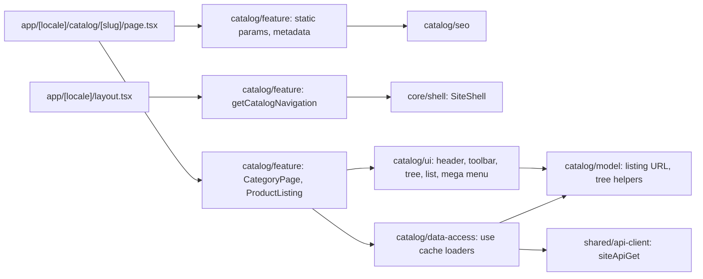

# Site catalog: category page, hub, search, and mega menu

**Entry points:** [category route](../../../apps/site/src/app/[locale]/catalog/[slug]/page.tsx) renders [CategoryPage](../../../libs/site/catalog/feature/src/lib/category/category-page.tsx); [hub route](../../../apps/site/src/app/[locale]/catalog/page.tsx) renders `CatalogHubPage`; [search route](../../../apps/site/src/app/[locale]/search/page.tsx) renders `SearchPage`; the [locale layout](../../../apps/site/src/app/[locale]/layout.tsx) passes `getCatalogNavigation` to the shell. Specification: [001 — Site category page](../../specs/site/catalog/001-category-page/README.md).

- **Category `/{locale}/catalog/{slug}`:** breadcrumbs, H1 (admin H1 or name) with the product count, category chips (the subcategories, or for a category without them its siblings with the current one marked), then filters on the left and products on the right, then the admin SEO text and FAQ in one quiet block ([category-content.tsx](../../../libs/site/catalog/ui/src/lib/category/category-content.tsx)): text beside the questions on wide screens, a text over 700 characters folds behind «Читати повністю» (a small client leaf; the whole text stays in the HTML), answers in native `<details>` from the shared [FaqList](../../../libs/site/shared/ui/src/lib/faq-list.tsx). There is no tree panel (owner decision 2026-11-01): the main sections are in the header. The category loads before streaming: a former slug or a deleted category answers 308 to the current or parent slug, an unknown slug 404, an unavailable API 500 inside the site frame ([error.tsx](../../../apps/site/src/app/[locale]/error.tsx)).
- **Listing:** 20 products per page by default (20, 50, or 100 from links under the list, `perPage` in the URL), in stock first; card or table row with photo (a photo missing on the CDN falls back to the placeholder, loaded without the Next.js optimizer), SKU (1C code, labelled «Артикул» everywhere), name, stock, badges, retail price in the site-wide format (`1 245 грн`, from `formatPrice` in core/i18n), and a one-tap «У кошик» from the cart domain. Filters «Тільки в наявності», «Акція», «Новинки», and the price range sit in the left column on desktop and open from an icon on phones (a GET form; a dot on the icon marks active filters); above the products a sort select and the card or table switch. Every choice is in the URL through the [listing model](../../../libs/site/catalog/model/src/lib/listing/listing-query.ts). Under the list: «Показано 51–100 з …», the page-size links, and page numbers, all plain links. Empty and failed results say so and offer a way back.
- **Mega menu:** the header «Каталог» button opens a rail of sections (doors last after a divider), the hovered section's subcategories with their children and «Усі товари розділу», a category search over the whole tree, and links to the hub and «Співпраця». All links are in the server HTML. The category row and phone menu list the live sections, or the fixed ones when the API is down.
- **Site roots:** the whole site sells hardware, so «Фурнітура» never appears: its sections are the top level of the tree, mega menu, header row, hub, sitemap, and breadcrumbs, followed by «Двері»; its own page answers 308 to the hub. Cosmos is never shown (the API hides it too). IDs live in [catalog-roots.ts](../../../libs/site/catalog/model/src/lib/roots/catalog-roots.ts).
- **Hub `/{locale}/catalog`** shows the hardware sections as photo cards (count and first subcategories), then «Двері» with its own cards, like the former storefront «Категорії» page; photos are in `apps/site/public/assets/categories/`. **Search `/{locale}/search?q=`** (header and home forms) lists products by name or SKU with the same filters and controls, scrolls to «Результати пошуку «…»» when a search lands, and is never indexed.
- **SEO:** [catalog seo](../../../libs/site/catalog/seo/src/index.ts) builds titles and descriptions (admin text first), self canonical for page 1 and `?page=N`, `noindex, follow` with the page 1 canonical for filters, sort, view, page size, and pages past the end; `BreadcrumbList` and `ItemList` JSON-LD. The sitemap lists the hub and every category. Old storefront addresses redirect permanently in [next.config.ts](../../../apps/site/next.config.ts).
- **Caching:** tree, category, and product pages use `'use cache'` with tags `catalog`, `catalog:categories`, `category:{slug}`, `catalog:products` and `cacheLife('hours')`; failures are cached for a minute. Top-level sections are prerendered; other categories render on first request.

## Architecture



## Code structure

```text
apps/site/src/app/[locale]/
├── catalog/page.tsx, catalog/[slug]/page.tsx, search/page.tsx  # thin routes
└── error.tsx  # 500 inside the site frame
libs/site/catalog/
├── model/src/lib/  # entities/, paths/, listing/ (URL model), tree/ (search, ancestors), roots/ (site roots)
├── data-access/src/lib/  # loaders/ (catalog, category, product), mappers/, requests/, cache-tags.ts
├── ui/src/lib/  # category/, category-cards/, listing/, popover/, product/, navigation/, catalog-index/, i18n/locales/
├── seo/src/lib/  # metadata/ (category, hub, search, texts), json-ld/
└── feature/src/lib/  # category/, listing/, hub/, search/, navigation/, routing/
libs/site/core/shell/src/lib/navigation/catalog-navigation.ts  # CatalogNavigation prop and fallback
```

## Tests

- `npx nx run site-catalog-feature:vite:test -- --run` (also `site-catalog-model`, `site-catalog-data-access`, `site-catalog-ui`, `site-catalog-seo`, `site-core-shell`), or `npm run test:site`.
- `npx nx run site:build`: the route table shows the category, hub, and search routes as partial prerender.

Related: [site shell](shell.md), [site home page](home.md), [SEO architecture](../../architecture/site/platform/seo-architecture.md).
