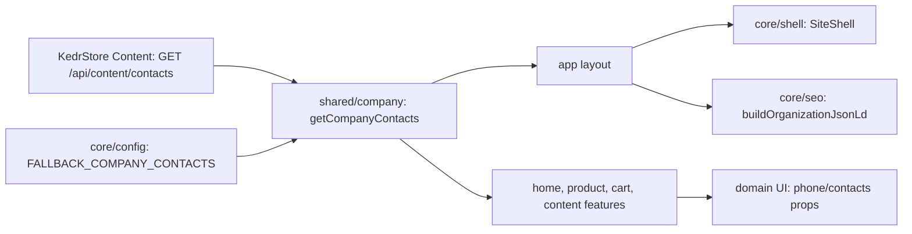

# Site company contacts

**Status:** implemented. Source: `GET /api/content/contacts` ([contract](../../contracts/openapi/content/contacts.openapi.yaml)), edited in the admin ([admin company contacts](../admin/company-contacts.md)).

- [`getCompanyContacts()`](../../../libs/site/shared/company/src/lib/contacts/company-contacts-loader.ts) reads the record with `'use cache'`, tags `content` and `content:contacts`, and a ten-minute life. It derives the display phone `(0XX) YYY-ZZ-ZZ` and the Viber chat link.
- When the API cannot be reached it returns `FALLBACK_COMPANY_CONTACTS` from [core/config](../../../libs/site/core/config/src/lib/company-contacts.ts) for a minute and retries, so the phone never disappears and builds do not fail. Keep the fallback equal to the saved record.
- The [layout](../../../apps/site/src/app/[locale]/layout.tsx) passes the contacts to `SiteShell` (header, mobile menu, footer, city line) and to Organization JSON-LD. Feature pages (home, product, checkout, contacts, wholesale, delivery, returns, offer, requisites, privacy) load them and pass a `phone` or `contacts` prop to their UI; UI components never import the loader.
- The privacy policy §8.1 has `{email}` and `{phone}` placeholders that the model fills with links.
- `COMPANY` keeps only the brand name and country.

## Architecture



## Code structure

```text
libs/site/core/config/src/lib/company-contacts.ts        # type, fallback, formatUaPhone, viberChatLink
libs/site/shared/company/src/lib/contacts/
├── company-contacts-loader.ts                           # cached read with fallback
├── company-contacts.mapper.ts                           # API row → site model
└── company-contacts-cache.ts                            # tags and cache life
```

## Tests

- `npx nx run site-shared-company:vite:test -- --run` — mapping, tags, fallback on failure.
- `npx nx run site-core-config:vite:test -- --run` — phone formatting and Viber link.
- `npx nx run site-core-shell:vite:test -- --run` — admin contacts in header and footer.
- `npx nx run site-core-seo:vite:test -- --run` — Organization JSON-LD uses the contacts.
- Domain features: `site-content-feature`, `site-home-feature`, `site-product-feature`, `site-cart-feature` mock the loader and check the phone links.
