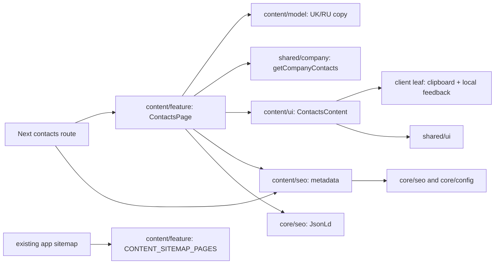

# Contacts

**Routes:** `/uk/contacts`, `/ru/contacts`. [SDD and accepted design](../../specs/site/content/001-contacts/README.md).

The page offers the sales phone, an independent copy action, Telegram, Viber, email and the configured map link. It shows the localized city, advice to arrange a visit, a wholesale contact strip and same-language delivery/returns links. Contacts come from `getCompanyContacts()` ([company contacts](company-contacts.md)), edited in the admin; copy comes from the content model. No contact form, backend operation or personal-data storage is introduced.

## Architecture



The route awaits and validates locale params. Main content and BreadcrumbList render on the server; only copying hydrates. Failed or unavailable clipboard access leaves a selectable number and a retry, without starting a call. The site shell retains the sole main region, skip-link, language/theme controls and header/footer. The existing layout owns Organization JSON-LD.

## Code structure

```text
apps/site/src/app/[locale]/(content)/contacts/page.tsx # thin locale route and metadata delegation
libs/site/content/
├── model/src/lib/
│   ├── contacts-types.ts                         # copy and public details contracts
│   └── contacts-dictionary.ts                    # complete UK/RU copy
├── ui/src/lib/contacts/
│   ├── contacts-content.tsx                      # page composition only
│   ├── contacts-header.tsx                       # breadcrumb, heading, intro and section anchors
│   ├── contacts-help.tsx                         # preparation and localized useful links
│   ├── contacts-channels.tsx                     # contact section and responsive grid
│   ├── contacts-sales.tsx                        # phone panel and clipboard inclusion
│   ├── contacts-messengers.tsx                   # written contact channels
│   ├── contacts-location.tsx                     # city, map and visit contact
│   ├── contacts-wholesale.tsx                    # wholesale contact strip
│   └── contacts-copy-phone-button.tsx            # only new client island
├── seo/src/lib/
│   ├── contacts-metadata.ts                      # localized core metadata wrapper
│   └── contacts-json-ld.ts                       # absolute two-item BreadcrumbList
└── feature/src/lib/
    ├── contacts-page.tsx                         # company/dictionary/UI/JSON-LD composition
    └── content-sitemap.ts                        # delivery, returns and contacts descriptors
```

Public exports live in each existing library's `src/index.ts`. No new Nx project, alias, global CSS or shell API is needed. Light/dark colors and responsive stacking use current site tokens; the page is not an embedded copy of the concept HTML.

## Tests

- `site-content-ui`: `npx nx run site-content-ui:vite:test -- --run src/lib/contacts/contacts-content.spec.tsx src/lib/contacts/contacts-copy-phone-button.spec.tsx` — two locales, section targets, contact destinations, clipboard success/rejection/unavailable/pending/retry and keyboard activation.
- `site-content-seo`: `npx nx run site-content-seo:vite:test -- --run contacts` — metadata, self canonical, reciprocal alternates/x-default, OG, indexing gates and absolute BreadcrumbList URLs.
- `site-content-feature`: `npx nx run site-content-feature:vite:test -- --run` — server company-fact integration, BreadcrumbList, no nested main, unique localized sitemap entries and preservation of delivery/returns.

Actual run results and verification limits are recorded in [SDD tasks](../../specs/site/content/001-contacts/tasks/README.md) and [SEO verification](../../specs/site/content/001-contacts/verification/seo-verification.md). Automated component/server-output checks do not establish real HTTP head/status or rendered geometry. Browser, production build and deployment require separate authorization.

[Architecture audit and verified fixes](../../specs/site/content/001-contacts/code-audit/audit.md): independent UI sections, mutation-checked navigation guard, scoped SEO dependency allowlist and corrected model lint inputs. Test TypeScript is additionally checked through the content UI/SEO/feature tsconfig.spec.json files.
