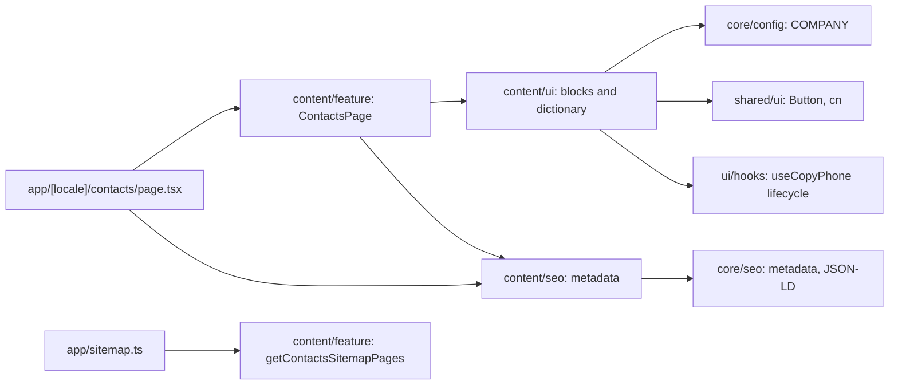

# Site contacts

**Entry:** [contacts route](../../../apps/site/src/app/[locale]/contacts/page.tsx), `/uk/contacts` and `/ru/contacts`. [Specification](../../specs/site/content/001-contacts/README.md).

- Server-rendered breadcrumbs, H1, sales phone with `tel:` action, Telegram, Viber, email, Kharkiv location with Maps, and wholesale preparation checklist.
- Public values and channel URLs come from `COMPANY`. There is no form, message API, street address, opening schedule, or embedded map.
- The clipboard button is the only new client island; its private `useCopyPhone` hook owns pending → success (cleared after two seconds) or error. The component owns the button and localized live feedback. It never initiates a call after a clipboard error.
- Shared shell, Onest, light/dark tokens, and locale switching are inherited. At `lg` the four blocks form two columns; below it they follow DOM order: sales, written channels, location, wholesale.
- Domain metadata calls `core/seo`; `ContactPage` and `BreadcrumbList` link to the layout's existing `Organization`. The app adds contacts to the sitemap; indexing follows site flags.

## Architecture



## Code structure

```text
apps/site/src/app/[locale]/contacts/page.tsx  # thin localized route and metadata
libs/site/content/
├── ui/src/lib/
│   ├── contacts/
│   │   ├── contacts-heading.tsx  # breadcrumbs, H1, introduction
│   │   ├── sales-contact.tsx  # phone and call action
│   │   ├── copy-phone-button.tsx  # copy button, icon, localized live feedback
│   │   ├── written-channels.tsx  # messengers and mail
│   │   ├── location-card.tsx  # city and Maps
│   │   └── wholesale-contact.tsx  # checklist and Telegram
│   ├── hooks/use-copy-phone.ts  # clipboard, state, single-flight guard, timer
│   └── i18n/contacts-dictionary.ts  # typed uk/ru copy
├── seo/src/lib/
│   ├── contacts-metadata.ts  # path, localized title/description, shared metadata
│   └── contacts-json-ld.ts  # ContactPage and breadcrumbs
└── feature/src/lib/
    ├── contacts-page.tsx  # page composition, DOM order, JSON-LD
    └── contacts-sitemap.ts  # locale-free sitemap entry
```

## Tests

- `site-content-ui`: `contacts-ui.spec.tsx`, `copy-phone-button.spec.tsx` — public channel URLs, uk/ru content, keyboard copying, pending requests, success timer, unavailable/rejected clipboard, retry.
- `site-content-seo`: `contacts-seo.spec.ts` — metadata, both locale paths, indexing configurations, structured data.
- `site-content-feature`: `contacts-page.spec.tsx`, `contacts-sitemap.spec.ts` — initial server markup, DOM order, locale switching paths, sitemap entries/alternates.
- Focused command per project: `npx nx run <project>:vite:test -- --run`. In the managed executor use `NX_NATIVE_COMMAND_RUNNER=false NX_TUI=false NX_DAEMON=false NX_ISOLATE_PLUGINS=false` if native task execution fails silently.
- [Execution evidence and verification limits](../../specs/site/content/001-contacts/verification/implementation.md). No browser, visual, HTTP production smoke, or build results are claimed.
- [Architecture audit and responsibility split](../../specs/site/content/001-contacts/code-audit/audit.md): local TS-005 refactoring, no public API or behavior change.
