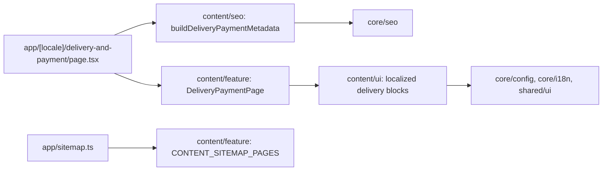

# Site delivery and payment

**Routes:** `/uk/delivery-and-payment`, `/ru/delivery-and-payment`. The [thin route](../../../apps/site/src/app/[locale]/delivery-and-payment/page.tsx) renders the static feature inside the existing locale SiteShell. [Specification](../../specs/site/content/001-delivery-payment/README.md), including the accepted concept and verification evidence.

The page shows the complete source introduction, delivery and payment terms, four ordering steps, important conditions/public offer and the configured company contact. Ukrainian and Russian text is copied from the Angular delivery dictionary as independent site content. There is no runtime Angular import, API call, checkout or payment processing. Pickup is omitted because its conditions are not specified in the source.

- Delivery and payment use two columns from `lg`, one on phones; ordering steps reflow from one to two to four columns. All substantive conditions stay visible.
- Onest, existing Tailwind light/dark tokens, shared Button and lucide icons come from the site design system. Existing shell owns language, theme, navigation, search and catalog.
- Semantic headings, section anchor links with sticky-header clearance, ordered steps, localized public-offer links and configured `tel:` actions.
- Server-renderable components and static dictionaries; no new client state, external widget, fetch or cache policy.
- Domain SEO delegates to core metadata: unique localized title/description, self canonical, UK/RU/x-default alternates, Open Graph and existing production indexing gate. App sitemap combines content descriptors with home and catalog; no invented modification date.

## Structure diagram



## Code structure

```text
libs/site/content/
├── ui/src/lib/
│   ├── i18n/delivery-payment-dictionary.ts  # exact standalone UK/RU copy
│   └── delivery-payment/  # header/anchors, terms, order steps, important/offer, contact, UI tests
├── seo/src/lib/delivery-payment-metadata.ts  # localized domain metadata and unit tests
└── feature/src/lib/
    ├── delivery-payment-page.tsx  # server composition and focused integration tests
    └── content-sitemap.ts  # static public route descriptors
apps/site/src/app/
├── [locale]/delivery-and-payment/page.tsx  # params/locale and domain delegation
└── sitemap.ts  # home, catalog and content descriptors
```

## Tests

- `npx nx run site-content-ui:vite:test -- --run`: source conditions and qualifications, UK/RU, ordering, anchors/semantics, offer and phone.
- `npx nx run site-content-seo:vite:test -- --run`: metadata/canonical/alternates/Open Graph and indexing gates.
- `npx nx run site-content-feature:vite:test -- --run`: complete server HTML in both languages and sitemap integration preserving home/catalog.
- Direct equivalent when Nx bootstrap stalls: `node node_modules/vitest/vitest.mjs run --config libs/site/content/<layer>/vite.config.mts` for the affected layer.
- All three libraries are included in `npm run test:site`; full suite and browser/build checks follow repository authorization rules.

Related: [site shell](shell.md), [SEO architecture](../../architecture/site/platform/seo-architecture.md), [original Angular information pages](../storefront/content/about-us.md).

Architecture and responsibility audit: [report and verified AF-001](../../specs/site/content/001-delivery-payment/code-audit/audit.md). The three content projects use inferred Nx ESLint inputs, including the current root/local CJS configs and upstream dependencies. Delivery tests are also typed through each library tsconfig.spec.json; see [TS-005](../../specs/site/content/001-delivery-payment/tasks/TS-005-architecture-audit.md) for exact checks.
