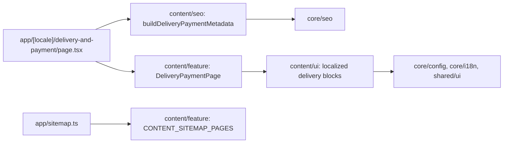

# Site delivery and payment

**Routes:** `/uk/delivery-and-payment`, `/ru/delivery-and-payment`. The [thin route](../../../apps/site/src/app/[locale]/delivery-and-payment/page.tsx) renders the static feature inside the existing locale SiteShell. [Specification](../../specs/site/content/001-delivery-payment/README.md), including the accepted concept and verification evidence.

The page shows the published delivery & payment edition (no «Редакція від» date) and the configured company contact: the text before the first H2 is the lead under the title, each H2 section is a card with an anchor link, and a section with a numbered list becomes full-width steps. There is no checkout or payment processing.

**Text source (2026-11-04):** the legal body is the published edition from the admin ([Admin site documents](../admin/documents.md)), read by `getLegalDocument(locale, 'delivery-payment')` in `content/data-access` (cache tag `content:document:delivery-payment`, ten-minute life) and turned into sections by `buildLegalDocument` in `content/model`: H2 headings become sections and contents, `{site}`, `{email}` and `{phone}` are filled from the site host and saved contacts. Nothing published answers 404; an API failure is an error, never an empty page. Page chrome stays in code. Pickup is omitted because its conditions are not specified in the source.

- Delivery and payment use two columns from `lg`, one on phones; ordering steps reflow from one to two to four columns. All substantive conditions stay visible.
- Onest, existing Tailwind light/dark tokens, shared Button and lucide icons come from the site design system. Existing shell owns language, theme, navigation, search and catalog.
- Semantic headings, section anchor links with sticky-header clearance, ordered steps, localized public-offer links and configured `tel:` actions.
- Server-rendered components; the text comes from the Content API through the cached document loader.
- Domain SEO delegates to core metadata: unique localized title/description, self canonical, UK/RU/x-default alternates, Open Graph and existing production indexing gate. App sitemap combines content descriptors with home and catalog; no invented modification date.

## Structure diagram



## Code structure

```text
libs/site/content/
├── ui/src/lib/
│   ├── i18n/delivery-payment-dictionary.ts  # page chrome UK/RU
│   ├── documents/  # shared DocumentHtml and EditionDate
│   └── delivery-payment/  # header/anchors, section cards, contact, UI tests
├── seo/src/lib/delivery-payment-metadata.ts  # localized domain metadata and unit tests
└── feature/src/lib/
    ├── delivery-payment-page.tsx  # server composition and focused integration tests
    └── content-sitemap.ts  # static public route descriptors
apps/site/src/app/
├── [locale]/delivery-and-payment/page.tsx  # params/locale and domain delegation
└── sitemap.ts  # home, catalog and content descriptors
```

## Tests

- `npx nx run site-content-ui:vite:test -- --run`: source conditions and qualifications, UK/RU, ordering, anchors/semantics, offer and phone.
- `npx nx run site-content-seo:vite:test -- --run`: metadata/canonical/alternates/Open Graph and indexing gates.
- `npx nx run site-content-feature:vite:test -- --run`: complete server HTML in both languages and sitemap integration preserving home/catalog.
- Direct equivalent when Nx bootstrap stalls: `node node_modules/vitest/vitest.mjs run --config libs/site/content/<layer>/vite.config.mts` for the affected layer.
- All three libraries are included in `npm run test:site`; full suite and browser/build checks follow repository authorization rules.

Related: [site shell](shell.md), [SEO architecture](../../architecture/site/platform/seo-architecture.md), [original Angular information pages](../storefront/content/about-us.md).

Architecture and responsibility audit: [report and verified AF-001](../../specs/site/content/001-delivery-payment/code-audit/audit.md). The three content projects use inferred Nx ESLint inputs, including the current root/local CJS configs and upstream dependencies. Delivery tests are also typed through each library tsconfig.spec.json; see [TS-005](../../specs/site/content/001-delivery-payment/tasks/TS-005-architecture-audit.md) for exact checks.
