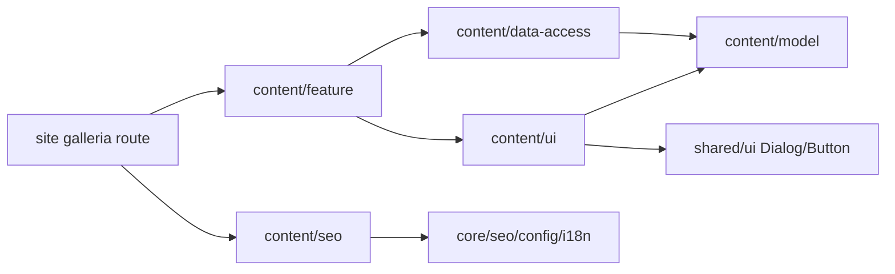

# Gallery and video — Site

**Routes:** /uk/galleria, /ru/galleria. **Status:** implemented locally 2026-11-03; first video stage approved, photographs next stage. [SDD](../../specs/site/content/001-gallery/README.md).

Gallery uses A composition, existing shell/light-dark/UK-RU. One collection filters all/photo/video, reveals7+4 and opens an accessible Dialog. Viewer traverses full filtered collection, returns focus and removes iframe on close/change; autoplay disabled. Native links work before hydration; image recovery and original/reload actions are present.

Server-only curated source contains all 7 public videos from [Kedr Class](https://www.youtube.com/@kedrclass2334/videos) and original JPEG 480×360. RU titles retained, UK translated literally; duplicate-title IDs remain distinct. No channel polling/backend/API/CMS. Photos supported and tested with mixed fixtures, real source deferred by owner. [Source proof](../../specs/site/content/001-gallery/design/media-source.md).

## Structure diagram



## Code structure

```text
apps/site/src/app/[locale]/(content)/galleria/page.tsx  thin route/metadata
apps/site/public/images/gallery/*.jpg                7 real posters
libs/site/content/model/src/lib/gallery/              types/copy/filter/portions
libs/site/content/data-access/src/lib/gallery-source.ts  curated authoring
libs/site/content/data-access/src/lib/gallery.ts          validation/locale models
libs/site/content/ui/src/lib/gallery/
  gallery-header.tsx   server-compatible breadcrumb/H1
  gallery-browser.tsx  filter/portion/selection session
  gallery-filters.tsx  format controls
  gallery-grid.tsx     featured/regular composition
  gallery-card.tsx     native href and enhanced activation
  media-image.tsx      loading/error/retry
  media-viewer.tsx     dialog/navigation/focus return
  video-frame.tsx      provider/lifecycle/recovery
libs/site/content/seo/src/lib/gallery-{metadata,json-ld}.ts
libs/site/content/feature/src/lib/gallery-page.tsx     server composition/noscript/JSON-LD
libs/site/content/feature/src/lib/content-sitemap.ts   existing descriptors + gallery
libs/site/shared/ui/src/lib/dialog.tsx                 Radix primitive
```

UI never imports data-access, SEO remains core-only. Cross-library imports use public indexes. Client receives only selected-locale models; state is local, source/locale changes reset it. Unknown locale uses existing isLocale/notFound. Filter/reveal/viewer do not change URL/history.

## Tests

Projects/counts: model13, data-access44, UI28, SEO10, feature14, shared UI3 —112 passed. Select commands by affected risk, not as a mandatory bundle.

```text
node node_modules/vitest/vitest.mjs run --config libs/site/content/model/vite.config.mts src/lib/gallery/gallery.spec.ts
node --max-old-space-size=512 node_modules/vitest/vitest.mjs run --maxWorkers=1 --no-file-parallelism --config libs/site/content/data-access/vite.config.mts src/lib/gallery.spec.ts
node --max-old-space-size=512 node_modules/vitest/vitest.mjs run --maxWorkers=1 --no-file-parallelism --config libs/site/content/ui/vite.config.mts src/lib/gallery/gallery-browser.spec.tsx src/lib/gallery/media-viewer.spec.tsx
node --max-old-space-size=512 node_modules/vitest/vitest.mjs run --environment=node --maxWorkers=1 --no-file-parallelism --config libs/site/content/seo/vite.config.mts src/lib/gallery-metadata.spec.ts src/lib/gallery-json-ld.spec.ts
node --max-old-space-size=512 node_modules/vitest/vitest.mjs run --maxWorkers=1 --no-file-parallelism --config libs/site/content/feature/vite.config.mts src/lib/gallery-page.spec.tsx src/lib/content-sitemap.spec.ts
node --max-old-space-size=512 node_modules/vitest/vitest.mjs run --maxWorkers=1 --no-file-parallelism --config libs/site/shared/ui/vite.config.mts src/lib/dialog.spec.tsx
```

These configs back the repository vite:test targets. Next typegen+app tsc and scoped spec types passed. Browser/manual/visual/E2E/build/HTTP/CWV/live playback not run. [Evidence](../../specs/site/content/001-gallery/verification/local-review.md).

## Architecture audit

The requested [gallery architecture audit](../../specs/site/content/001-gallery/code-audit/audit.md) is verified. [TS-008](../../specs/site/content/001-gallery/tasks/TS-008-architecture-audit.md) fixes poster inputs for the inferred source-test target, client-island inventory and Dialog import groups. The target appends its asset glob with Nx24 spread, preserving inferred inputs and avoiding an app dependency. Existing components already separate collection session, image recovery, controlled viewer and iframe lifecycle; no extra split was needed. Routes, public APIs and the approved video-first content remain unchanged.
