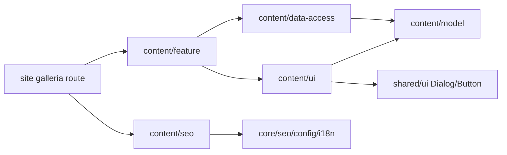

# Gallery and video — Site

**Routes:** /uk/galleria, /ru/galleria. **Status:** implemented; cards come from the KedrStore Content API since 2026-11-04 and are edited in the [admin «Галерея»](../admin/gallery.md). [SDD](../../specs/site/content/001-gallery/README.md).

Gallery uses A composition, existing shell/light-dark/UK-RU. One collection filters all/photo/video, reveals7+4 and opens an accessible Dialog. Viewer traverses full filtered collection, returns focus and removes iframe on close/change; autoplay disabled. Native links work before hydration; image recovery and original/reload actions are present.

The cards come from `GET /api/content/{lang}/gallery` ([contract](../../contracts/openapi/content/gallery.openapi.yaml)) in the order set in the admin: photos from the media library (CDN URL and size) and YouTube videos with their poster from `i.ytimg.com`. A card without a title gets «Фото» or «Відео» from the dictionary. The loader caches the list for five minutes (one minute after a failure) under the tags `content` and `content:gallery`. When the API is unavailable the page fails (500) instead of showing an empty gallery. The 7 public videos of [Kedr Class](https://www.youtube.com/@kedrclass2334/videos) that used to live in code are seeded by the backend migration.

## Structure diagram



## Code structure

```text
apps/site/src/app/[locale]/(content)/galleria/page.tsx  thin route/metadata
libs/site/content/model/src/lib/gallery/              types/copy/filter/portions
libs/site/content/data-access/src/lib/gallery/
  gallery-loader.ts    cached API read, ok | unavailable
  gallery.mapper.ts    API items to locale models, title fallbacks
  gallery-cache.ts     cache tags and lifetimes
libs/site/content/ui/src/lib/gallery/
  gallery-header.tsx   server-compatible breadcrumb/H1
  gallery-browser.tsx  fresh collection per locale and content
  collection/          gallery-collection.tsx, use-gallery-collection.ts (filter/portion/selection), gallery-empty.tsx
  gallery-filters.tsx  format controls
  gallery-grid.tsx     featured/regular composition
  gallery-card.tsx     native href and enhanced activation
  media/media-image.tsx      loading/error/retry
  media/media-viewer.tsx     dialog/navigation/focus return
  media/video-frame.tsx      provider/lifecycle/recovery
libs/site/content/seo/src/lib/{metadata,json-ld}/gallery/gallery-{metadata,json-ld}.ts
libs/site/content/feature/src/lib/gallery/gallery-page.tsx     server composition/noscript/JSON-LD
libs/site/content/feature/src/lib/sitemap/content-sitemap.ts   existing descriptors + gallery
libs/site/shared/ui/src/lib/dialog.tsx                 Radix primitive
```

UI never imports data-access, SEO remains core-only. Cross-library imports use public indexes. Client receives only selected-locale models; state is local, source/locale changes reset it. Unknown locale uses existing isLocale/notFound. Filter/reveal/viewer do not change URL/history.

## Tests

Select commands by affected risk, not as a mandatory bundle. The API loader and mapper: `npx nx run site-content-data-access:vite:test -- --run`.

```text
node node_modules/vitest/vitest.mjs run --config libs/site/content/model/vite.config.mts src/lib/queries/gallery.spec.ts
node --max-old-space-size=512 node_modules/vitest/vitest.mjs run --maxWorkers=1 --no-file-parallelism --config libs/site/content/data-access/vite.config.mts src/lib/gallery/gallery-loader.spec.ts
node --max-old-space-size=512 node_modules/vitest/vitest.mjs run --maxWorkers=1 --no-file-parallelism --config libs/site/content/ui/vite.config.mts src/lib/gallery/gallery-browser.spec.tsx src/lib/gallery/media/media-viewer.spec.tsx
node --max-old-space-size=512 node_modules/vitest/vitest.mjs run --environment=node --maxWorkers=1 --no-file-parallelism --config libs/site/content/seo/vite.config.mts src/lib/metadata/gallery/gallery-metadata.spec.ts src/lib/json-ld/gallery/gallery-json-ld.spec.ts
node --max-old-space-size=512 node_modules/vitest/vitest.mjs run --maxWorkers=1 --no-file-parallelism --config libs/site/content/feature/vite.config.mts src/lib/gallery/gallery-page.spec.tsx src/lib/sitemap/content-sitemap.spec.ts
node --max-old-space-size=512 node_modules/vitest/vitest.mjs run --maxWorkers=1 --no-file-parallelism --config libs/site/shared/ui/vite.config.mts src/lib/dialog.spec.tsx
```

These configs back the repository vite:test targets. Next typegen+app tsc and scoped spec types passed. Browser/manual/visual/E2E/build/HTTP/CWV/live playback not run. [Evidence](../../specs/site/content/001-gallery/verification/local-review.md).

## Architecture audit

The requested [gallery architecture audit](../../specs/site/content/001-gallery/code-audit/audit.md) is verified. [TS-008](../../specs/site/content/001-gallery/tasks/TS-008-architecture-audit.md) fixes poster inputs for the inferred source-test target, client-island inventory and Dialog import groups. The target appends its asset glob with Nx24 spread, preserving inferred inputs and avoiding an app dependency. Existing components already separate collection session, image recovery, controlled viewer and iframe lifecycle; no extra split was needed. Routes, public APIs and the approved video-first content remain unchanged.
