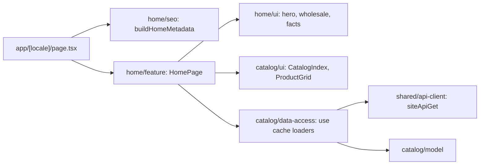

# Site home page

**Entry point:** [home route](../../../apps/site/src/app/[locale]/page.tsx) renders [HomePage](../../../libs/site/home/feature/src/lib/home-page.tsx) for `/uk` and `/ru`. Specification: [001 — Site home page](../../specs/site/home/001-home-page/README.md).

- **Hero:** the page's only H1, a lead paragraph, and a GET search form to `/{locale}/catalog/products?search=`.
- **Wholesale panel:** four partner benefits, «Стати партнером» to `/{locale}/wholesale`, and a call link.
- **Catalog index:** top-level categories from `GET /api/catalog/{lang}/categories` with up to eight subcategory links each and an «all» link; a notice with a link to all products when the API is unavailable.
- **In stock:** up to eight newest in-stock products from `GET /api/catalog/{lang}/products` (photo or placeholder, badges, retail price or «price on request»); hidden when there is no data.
- **Facts** and **WebSite JSON-LD**; title, description, canonical, `hreflang`, and Open Graph from [home seo](../../../libs/site/home/seo/src/lib/home-metadata.ts).
- **Caching:** loaders use `'use cache'`, tags `catalog`, `catalog:categories`, `catalog:products`, and `cacheLife('hours')`; a failed read is cached for a minute and retried in the background. `/{locale}/categories` redirects permanently to the home page.

## Architecture



## Code structure

```text
libs/site/catalog/
├── model/src/lib/  # catalog-model.ts types, catalog-paths.ts URLs
├── data-access/src/lib/  # loaders/catalog-loaders.ts, mappers/, cache-tags.ts
└── ui/src/lib/  # catalog-index/, product/ (card, grid), format/price.ts, i18n/
libs/site/home/
├── ui/src/lib/  # hero/, wholesale/, facts/, layout/home-section.tsx, notice/, i18n/home-dictionary.ts
├── seo/src/lib/home-metadata.ts
└── feature/src/lib/home-page.tsx
```

## Tests

- `npx nx run site-home-feature:vite:test -- --run` (also `site-home-ui`, `site-home-seo`, `site-catalog-model`, `site-catalog-data-access`, `site-catalog-ui`), or `npm run test:site`.
- Rendered HTML: `npx nx run site:build`, then `curl` against `next start` as in the [SEO verification](../../specs/site/home/001-home-page/verification/seo-verification.md).

Related: [site shell](shell.md), [rendering and caching](../../architecture/site/platform/rendering-and-caching.md).
