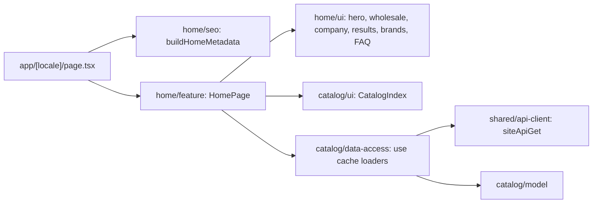

# Site home page

**Entry point:** [home route](../../../apps/site/src/app/[locale]/page.tsx) renders [HomePage](../../../libs/site/home/feature/src/lib/home-page.tsx) for `/uk` and `/ru`. Specification: [001 — Site home page](../../specs/site/home/001-home-page/README.md).

- **Hero:** the page's only H1, a lead paragraph, and a GET search form to `/{locale}/search?q=` from tablet width (phones already show the header search right above).
- **Wholesale panel:** four partner benefits, «Стати партнером» to `/{locale}/wholesale`, and a call link.
- **Catalog index:** top-level categories from `GET /api/catalog/{lang}/categories` with up to eight subcategory links each and an «all» link to `/{locale}/catalog/{slug}`; a notice with a link to the catalog hub when the API is unavailable.
- **No products** on the home page (owner decision 2026-11-01); the catalog index leads to them.
- **Company page:** the home is also the company page; `#about-company` targets the overview from the header, mobile menu and footer. Former `/{locale}/about-company` URLs permanently redirect (308) to their localized home, without a separate page, canonical or sitemap entry.
- **Company concept:** overview with four partner support points (assortment, stock, choice help, order support; the former six-item advantages block was merged into it 2026-11-04), four sourced results (15+, 15 000+, 50 000+, 1 000+), six local brand logos, and a six-question native FAQ. All content is server-rendered in Ukrainian/Russian; the first FAQ answer is open, native disclosure has scoped 200ms open/close and icon transitions (disabled for reduced motion), and manager links use the configured company phone.
- **WebSite JSON-LD**; title, description, canonical, `hreflang`, and Open Graph from [home seo](../../../libs/site/home/seo/src/lib/home-metadata.ts).
- **Caching:** loaders use `'use cache'`, tags `catalog` and `catalog:categories`, and `cacheLife('hours')`; a failed read is cached for a minute and retried in the background. `/{locale}/categories` redirects permanently to the home page.

## Architecture



## Code structure

```text
libs/site/catalog/
├── model/src/lib/  # entities/, paths/ (shared with the catalog pages, see catalog.md)
├── data-access/src/lib/  # loaders/catalog-loaders.ts, mappers/, cache-tags.ts
└── ui/src/lib/  # catalog-index/, product/ (card, grid), format/price.ts, i18n/
libs/site/home/
├── ui/src/lib/  # hero/, wholesale/, company/ (overview with partner support, results, brands, FAQ), layout/, notice/, i18n/ (home and company dictionaries)
├── seo/src/lib/home-metadata.ts
└── feature/src/lib/home-page.tsx
apps/site/public/assets/brands/  # six brand logos as WebP, 480 px wide (3-5 KB each)
```

## Tests

Company concept coverage lives in `home/feature/src/lib/home-page.spec.tsx`: both languages, the stable company anchor, all blocks during catalog failure, sourced numbers, six logos, initial FAQ disclosure and manager phone. Native disclosure behavior uses the browser implementation.

- `npx nx run site-home-feature:vite:test -- --run` (also `site-home-ui`, `site-home-seo`, `site-catalog-model`, `site-catalog-data-access`, `site-catalog-ui`), or `npm run test:site`.
- Rendered HTML: `npx nx run site:build`, then `curl` against `next start` as in the [SEO verification](../../specs/site/home/001-home-page/verification/seo-verification.md).

Related: [site shell](shell.md), [rendering and caching](../../architecture/site/platform/rendering-and-caching.md).
