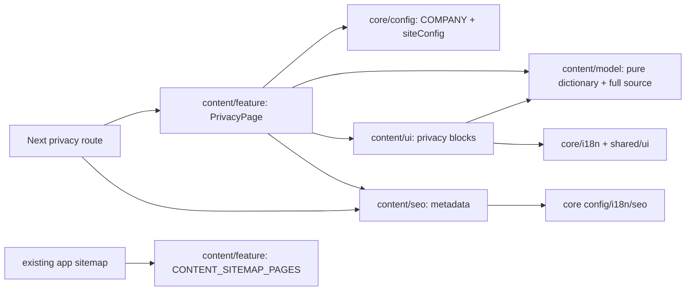

# Privacy policy / Политика конфиденциальности

**Route:** /{locale}/privacy-policy, locale uk/ru. [SDD and accepted concept](../../specs/site/content/001-privacy-policy/README.md).

The page provides a short data/purpose/rights summary, eight-section contents, the complete existing localized policy and configured contact links. Desktop has sticky contents; mobile/tablet uses native details before summary. The complete document stays outside disclosure and in server HTML. Existing shell, themes and language controls are reused.

## Structure diagram



## State, data and contracts

No API, data-access, page client state, observer or storage is added. Native links/details and scoped :target/:has styling provide navigation. Selected contents follows the URL fragment; it does not track manual scrolling.

Feature passes new URL(siteConfig.siteUrl).host, COMPANY.email, COMPANY.phone.display and tel: + COMPANY.phone.e164 to the pure model. All 8 source headings, 15 paragraphs and 11 list items per locale remain. Only documented domain/contact replacements and the UK duplicate-verb correction in §4.1 are applied. Angular source is migration input, never a runtime dependency.

Email/tel and same-language public-offer remain real links. Domain metadata delegates to core SEO; the page adds BreadcrumbList, layout owns Organization. One additive sitemap descriptor yields both locales, without invented modification dates. Preview/dev indexing stays off.

## Code structure

```text
apps/site/src/app/[locale]/(content)/privacy-policy/page.tsx # thin async locale route
libs/site/content/
├── model/src/lib/
│   ├── privacy-types.ts                 # readonly view contract
│   ├── privacy-policy-copy.ts           # full sourced UK/RU text
│   ├── privacy-policy-sections.ts       # ordered keys and pure bindings
│   ├── privacy-dictionary.ts            # summary/labels and assembly
│   └── privacy-policy-sections.spec.ts  # full units/order/bindings
├── ui/src/lib/privacy/
│   ├── privacy-content.tsx              # responsive composition
│   ├── privacy-header.tsx               # breadcrumb/H1/intro
│   ├── privacy-summary.tsx              # three summary terms
│   ├── privacy-navigation.tsx           # native desktop/mobile TOC
│   ├── privacy-policy.tsx               # complete semantic document
│   ├── privacy-contact.tsx              # email CTA and related offer
│   ├── privacy-content.module.css       # scoped fragment selection
│   └── privacy-content.spec.tsx         # locales/HTML/anchors/contact
├── seo/src/lib/
│   ├── privacy-metadata.ts              # core metadata contract
│   ├── privacy-metadata.spec.ts         # canonical/alternates/gates
│   ├── privacy-json-ld.ts               # visible breadcrumb graph
│   └── privacy-json-ld.spec.ts          # locale/configured origin
└── feature/src/lib/
    ├── privacy-page.tsx                 # configured server composition
    ├── privacy-page.spec.tsx            # actual SSR + breadcrumb parity
    ├── content-sitemap.ts               # existing list + privacy descriptor
    └── content-sitemap.spec.ts          # privacy discovery + existing pages
```

The four existing public index.ts files expose the feature. No new Nx project or alias was needed.

## Tests

- **site-content-model:** node node_modules/vitest/vitest.mjs run --config libs/site/content/model/vite.config.mts src/lib/privacy-policy-sections.spec.ts — 6 tests, source completeness/order and independent bindings.
- **site-content-ui:** node node_modules/vitest/vitest.mjs run --config libs/site/content/ui/vite.config.mts src/lib/privacy/privacy-content.spec.tsx — 12 tests, both locales, initial server HTML, summary, targets, disclosure and contact.
- **site-content-seo:** node node_modules/vitest/vitest.mjs run --config libs/site/content/seo/vite.config.mts src/lib/privacy-metadata.spec.ts src/lib/privacy-json-ld.spec.ts — 12 tests, metadata and BreadcrumbList.
- **site-content-feature:** node node_modules/vitest/vitest.mjs run --config libs/site/content/feature/vite.config.mts src/lib/privacy-page.spec.tsx src/lib/content-sitemap.spec.ts — 9 tests, actual SSR and additive sitemap regression.
- **site app boundary:** direct next typegen + tsc --noEmit -p tsconfig.json from apps/site — exit 0, exact body of site:typecheck. Nx worker wrapper failed before compilation; no project config workaround was committed.

39 focused tests passed. Browser/HTTP/build were not run. Responsive/theme/sticky/hash wiring was reviewed from source; actual keyboard/history/visual behavior is not claimed as browser-verified. [Evidence and limits](../../specs/site/content/001-privacy-policy/verification/seo-verification.md).

[Architecture audit and quality fixes](../../specs/site/content/001-privacy-policy/code-audit/audit.md) — AF-001/AF-002 verified 2026-11-03. No mixed-responsibility or dependency violations were confirmed. Import ordering and UI-test typing fixed; 19-file lint, scoped test types and 12 UI regression cases passed.
