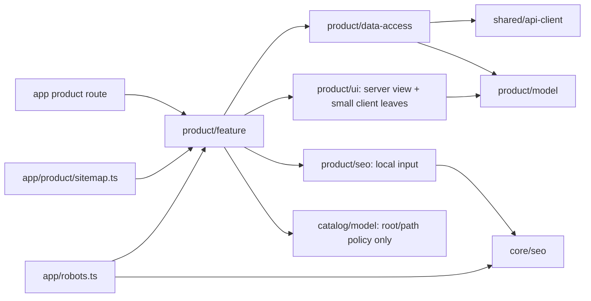

# Site product details

**Route:** [product/[slug]/page.tsx](../../../apps/site/src/app/[locale]/product/[slug]/page.tsx), `/{locale}/product/{slug}`. [SDD](../../specs/site/product/001-product-details/README.md). **Status:** independent migration stage 4A implemented 2026-11-03; real purchase remains blocked by EN-002, the shared Site cart prerequisite.

The server renders the real product name, 1C SKU, category trail, retail UAH price or price-on-request, stock state and informational pack. The photo/scheme gallery, inline zoom and honest SKU clipboard feedback are client leaves. Product facts and service sections follow the approved light/dark UK/RU design; the existing Site shell is reused. The layout stacks below viewport `lg=1024`, uses two columns above it, and does not add a sticky purchase bar.

Stock and price are independent. No stock leads to the manager availability contact; unknown price leads to the price contact. Both facts remain visible when both are missing. For an available priced product, the purchase panel accepts a real `purchaseAction` slot; the current development default is disabled quantity/cart controls. There is no simulated add-success, second cart, order operation or unapproved contact-only fallback. Do not publish the complete purchase flow until EN-002/TS-005 are finished.

## Data, routing and SEO

- `getPublicProductBySlug`, `GET /api/catalog/{lang}/product/{productSlug}`, public price type11; [Site consumer projection](../../contracts/catalog/public-products.md#site-product-details-and-discovery). Generated aliases and unknown response parsing stay private in data-access `contracts/`; normalization stays in mappers.
- Shared typed GET, success `cacheLife('hours')`, short failure lifetime, `catalog`/`catalog:products`/product SKU/slug tags; no cookies, session or cart in the shared cache.
- Current URL renders the product; old slug permanently redirects, category redirect body permanently redirects to the category, bare missing is 404, unavailable data throws to the existing error frame. Resolution precedes streaming; `instant=false` follows the category route.
- Prerender uses real first-page candidates and at most five detail verifications per locale; there is no fake placeholder. If no real seed can be confirmed, preparation fails explicitly.
- Feature filters hidden catalog roots and resolves category destinations through the allowed `product-feature -> catalog-model` flow. One visible trail feeds UI and BreadcrumbList; ready `categoryHref` passes through the server view to identity, with no category URL policy in UI.
- Product SEO owns self canonical, confirmed same-SKU locale alternates, OG and Product/Offer/BreadcrumbList. Price-query omits Offer; there are no invented descriptions, brands or ratings. Existing JsonLd renderer escapes untrusted values.
- `/product/sitemap/{id}.xml` uses a bounded best-effort public index (All/IdAsc/100, maximum 1000 pages per locale, one inconsistency retry), no N detail calls and no fabricated `lastModified`. Shards are at most 20,000 URL and below a conservative 40 MiB UTF-8 budget. Product sitemap URLs are supplied to robots at app level; preview remains blocked and skips that enumeration. Root `/sitemap.xml` remains intact.

## Architecture



## Actual structure

```text
apps/site/src/app/
├── [locale]/product/[slug]/page.tsx   # thin product entry
├── product/sitemap.ts               # thin sharded metadata entry
└── robots.ts                        # passes product discovery URLs to core
libs/site/product/
├── model/src/lib/                   # entities, result unions, paths, purchase rules
├── data-access/src/lib/
│   ├── contracts/                  # private generated aliases and unknown-body parser
│   ├── loaders/, mappers/           # typed detail GET and domain normalization
│   ├── crawling/                    # index page transport, walker and cache
│   └── cache-tags.ts
├── ui/src/lib/
│   ├── detail/, identity/, details/ # server composition, SKU leaf, facts
│   ├── gallery/                     # selection/failure/zoom + real image
│   ├── purchase/, service/          # price/action slot, conditions/contact
│   └── i18n/                        # typed UK/RU copy
├── seo/src/lib/                     # input, metadata, JSON-LD and URL helpers
└── feature/src/lib/
    ├── detail/, mapping/, routing/  # page/crumbs, category/SEO mapping, identity/status/seeds
    └── crawling/                    # entries, XML budget/shards, server orchestration
```

The cart adapter/provider/checkout are not present in this feature. The contract snapshot is unchanged.

## Tests

From repository root, one focused target for the changed owner:

```powershell
npx nx run site-product-model:vite:test -- --run
npx nx run site-product-data-access:vite:test -- --run
npx nx run site-product-ui:vite:test -- --run
npx nx run site-product-seo:vite:test -- --run
npx nx run site-product-feature:vite:test -- --run
```

Installed direct `vitest.cmd run --config libs/site/product/<layer>/vite.config.mts` was used for the same scoped configs during delivery, avoiding repeated full Nx graph startup. Results: model33, data55, UI19, SEO9, feature42 — **158 product tests**. Modified core crawling tests: 5 passed; boundary fixtures:27 passed. Scoped source/test/app type checking, ESLint and architecture boundaries passed; see [implementation evidence](../../specs/site/product/001-product-details/verification/implementation.md).

Browser/visual/manual, live HTTP, production build, E2E and full app suite were not run. Responsive/theme conclusions are source/component evidence, not rendered browser inspection. Full purchase completion is blocked by EN-002.

Architecture follow-up: [scoped audit and fixes](../../specs/site/product/001-product-details/code-audit/audit.md) — AF-001/002/003. Fresh targeted checks: data55, UI detail3, feature mapping/SSR6 (64 tests); type projection24 roots, scoped ESLint and boundaries108 projects. The original158-test delivery result above is historical; no full suite was repeated.
