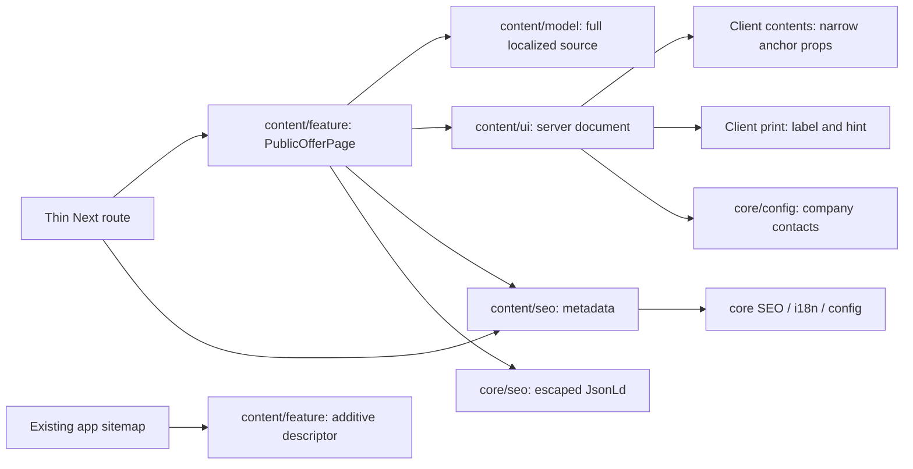

# Public offer

**Routes:** `/uk/public-offer`, `/ru/public-offer`. [SDD and accepted concept](../../specs/site/content/001-public-offer/README.md).

The page renders the published offer edition with its «Редакція від» date under the full title.

**Text source (2026-11-04):** the legal body is the published edition from the admin ([Admin site documents](../admin/documents.md)), read by `getLegalDocument(locale, 'public-offer')` in `content/data-access` (cache tag `content:document:public-offer`, ten-minute life) and turned into sections by `buildLegalDocument` in `content/model`: H2 headings become sections and contents, `{site}`, `{email}` and `{phone}` are filled from the site host and saved contacts. Nothing published answers 404; an API failure is an error, never an empty page. Page chrome stays in code.

Desktop has a sticky contents/contact rail; phones and tablets use native collapsed contents above an open document. Both themes use current site tokens and the existing shell. Configured contact links and localized delivery/returns links remain ordinary anchors.

## Structure diagram



## Code structure

```text
apps/site/
  src/app/[locale]/(content)/public-offer/
    page.tsx                           # params/locale guard/metadata
libs/site/content/
  feature/src/lib/public-offer/
    public-offer-page.tsx              # locale UI/JSON-LD composition
  feature/src/lib/sitemap/
    content-sitemap.ts                 # descriptor; other entries retained
  model/src/lib/copy/public-offer/
    public-offer-types.ts              # page chrome contract
    public-offer-ui-copy.ts            # localized controls and short labels
    public-offer-dictionary.ts         # chrome assembly
  seo/src/lib/json-ld/public-offer/
    public-offer-json-ld.ts            # visible BreadcrumbList
  seo/src/lib/metadata/public-offer/
    public-offer-metadata.ts           # localized metadata via core
  ui/src/lib/public-offer/document/
    public-offer-document.tsx          # every section of the published edition
    public-offer-toc.tsx               # native contents and active link
    use-public-offer-section.ts        # hash/observer/scroll lifecycle
    public-offer-print-button.tsx      # hydrated browser print action
    public-offer-print.module.css      # page-marker-scoped print styles
  ui/src/lib/public-offer/page/
    public-offer-content.tsx           # server responsive composition
    public-offer-header.tsx            # breadcrumb/title/print placement
    public-offer-contact.tsx           # configured contact and related links
```

## State, source and boundaries

No API, auth, data-access, persisted state or source freshness task is added. Source was copied from the old Storefront translations; Angular is not a runtime dependency. The frozen baseline in the SDD tests every original paragraph and note. Heading capitalization/splitting is presentation only.

The document stays in initial server markup. Contents receives seven anchor labels/IDs; the observer/hash/scroll enhancement does not own focus, history or scrolling. A local Toc ref scopes observed sections to its owning page/document, including when inactive pages with equal IDs remain cached. Its lifecycle is refreshed when translated labels or section IDs change. Native links/disclosure remain useful without JavaScript or observer support.

Printing starts disabled until hydration; a localized noscript hint explains the browser command. The button calls browser print without submitting, downloading or reporting success. CSS requires the visible local page marker (excluding hidden Activity hosts/ancestors), restores black-on-white output and hides the shop frame/controls, leaving all clauses and the final note. Actual printer pagination has not been checked.

The layout owns Organization JSON-LD. Page metadata, visible BreadcrumbList, self canonical and reciprocal alternates reuse core helpers. The sitemap adds both offer URLs without dates and preserves other content. The existing preview indexing gate remains unchanged. Privacy/requisites migration is independent; this page does not recreate the old duplicate privacy sidebar.

## Tests

Run only the relevant command for the changed responsibility from repository root:

- Model `site-content-model`: `npx nx run site-content-model:vite:test -- --run src/lib/copy/public-offer/public-offer-dictionary.spec.ts`.
- Page/contents/print `site-content-ui`: `npx nx run site-content-ui:vite:test -- --run src/lib/public-offer/`.
- Metadata/BreadcrumbList `site-content-seo`: `npx nx run site-content-seo:vite:test -- --run src/lib/metadata/public-offer/public-offer-metadata.spec.ts src/lib/json-ld/public-offer/public-offer-json-ld.spec.ts`.
- Sitemap `site-content-feature`: `npx nx run site-content-feature:vite:test -- --run src/lib/sitemap/content-sitemap.spec.ts`.

Focused package results and final integration evidence are in [implementation verification](../../specs/site/content/001-public-offer/verification/implementation.md). Test files sit beside the relevant source. The print-styles spec also compiles the installed Next CSS-module plugins and verifies retained Activity DOM isolation. Theme/breakpoint/print behavior is checked against source and controlled component mocks; browser, actual print preview, HTTP and production build remain unrun.

[Architecture and responsibility audit](../../specs/site/content/001-public-offer/code-audit/audit.md): existing server/client/model separation retained; import hygiene and historical-state wording corrected. Final verification is recorded in the audit.
