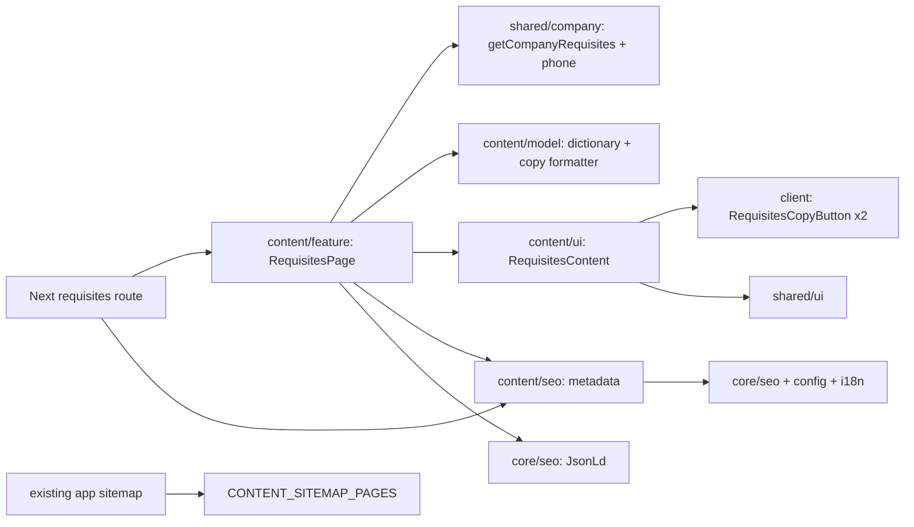

# Site requisites

**Routes:** `/uk/requisites`, `/ru/requisites`. [SDD](../../specs/site/content/001-requisites/README.md) и [принятый дизайн](../../specs/site/content/001-requisites/design/visual.md).

Страница показывает подтверждённые данные администрации ClassKedr и банковские реквизиты, копирует отдельно IBAN либо полный шестистрочный набор, предлагает согласовать оплату заказа с менеджером. UI поддерживает UK/RU, текущие light/dark tokens и mobile stacking. Официальное имя сохраняется на украинском в обеих локалях.

Локальная реализация выполнена 2026-11-03. С 2026-11-04 значения редактирует администратор ([admin company requisites](../admin/company-requisites.md)): [`getCompanyRequisites()`](../../../libs/site/shared/company/src/lib/requisites/company-requisites-loader.ts) читает `GET /api/content/requisites` с `'use cache'`, тегами `content` и `content:requisites` и десятиминутной жизнью; если API недоступен, минуту отдаёт `FALLBACK_COMPANY_REQUISITES` из core/config и повторяет. Держите fallback равным сохранённой записи. EN-001 закрыт владельцем; EN-002 остаётся внешним publication gate для оферты/политики. Public-offer route появился отдельно, privacy-policy в проверенных destinations ещё отсутствует. Source/компонентная проверка href не означает HTTP-доступность.

## Architecture



Core config владеет типом и запасными строками, model — presentation types, UK/RU copy и pure formatter. Feature собирает props/payload; UI не импортирует банковский config. SEO имеет отдельный маленький locale record по boundary allowlist. Данные приходят через shared/company; формы и персональное хранилище не добавлялись.

Весь основной контент и BreadcrumbList доступны в server HTML. Только copy leaf гидратируется: idle/pending/success/error, ref-guard, live status, selectable single/multiline fallback и retry. Clipboard error не вызывает звонок. Единственный main, shell, locale/theme controls и Organization остаются у существующих владельцев; WebSite принадлежит главной.

## Code structure

```text
apps/site/
  src/app/[locale]/(content)/requisites/
    page.tsx                           # thin async locale route/metadata
libs/site/core/
  config/src/lib/
    company-requisites.ts              # type and code fallback
libs/site/shared/
  company/src/lib/requisites/
                                       # cached API read, mapper, cache tags
libs/site/content/
  feature/src/lib/requisites/
    requisites-page.tsx                # config/model/UI/JSON-LD integration
  feature/src/lib/sitemap/
    content-sitemap.ts                 # one /requisites descriptor
  model/src/lib/copy/requisites/
    requisites-types.ts                # readonly presentation contracts
    requisites-dictionary.ts           # UK/RU interface labels
    requisites-copy.ts                 # exact six-line payload
  seo/src/lib/json-ld/requisites/
    requisites-json-ld.ts              # absolute two-item breadcrumbs
  seo/src/lib/metadata/requisites/
    requisites-metadata.ts             # core metadata wrapper
  ui/src/lib/requisites/
    requisites-content.tsx             # server composition/layout
    requisites-header.tsx              # breadcrumbs/H1/anchors
    requisites-copy-button.tsx         # only client leaf
  ui/src/lib/requisites/sections/
    requisites-administration.tsx      # official data panel
    requisites-bank.tsx                # bank/IBAN and copy actions
    requisites-payment.tsx             # agreement before payment
    requisites-support.tsx             # support layout/composition
    requisites-legal-links.tsx         # legal navigation
    requisites-contact-card.tsx        # manager phone/call
```

Public exports дополняют existing core/config и content libraries. Новых Nx projects, dependencies, aliases, shell API и global CSS нет. Длинный IBAN/имя переносимы; copy использует raw значения независимо от визуальных переносов.

## Tests

Команды focused; это не обязательный full-suite пакет:

- `site-content-model`: `npx nx run site-content-model:vite:test -- --run src/lib/copy/requisites/requisites-copy.spec.ts` — порядок/точность payload, labels и immutable values.
- `site-content-ui`: `npx nx run site-content-ui:vite:test -- --run src/lib/requisites/requisites-content.spec.tsx src/lib/requisites/requisites-copy-button.spec.tsx` — локали/семантика/назначения и controlled clipboard states.
- `site-content-seo`: `npx nx run site-content-seo:vite:test -- --run src/lib/metadata/requisites/requisites-metadata.spec.ts src/lib/json-ld/requisites/requisites-json-ld.spec.ts` — self canonical, alternates/indexing и breadcrumbs.
- `site-content-feature`: `npx nx run site-content-feature:vite:test -- --run src/lib/requisites/requisites-page.spec.tsx src/lib/sitemap/content-sitemap.spec.ts` — server facts, реальный UI payload и sitemap registry.
- `npx nx run site:typecheck` — Next route/type integration; фактический результат этого этапа использовал Nx cache.

Получены 43 passing tests в последних узких прогонах, scoped lint pass и source review. [Точные результаты и пределы](../../specs/site/content/001-requisites/verification/seo-verification.md) различают unit/component/server evidence, source/type guards и незапущенные HTTP/browser/build проверки.

## Architecture audit

[Аудит и исправление AF-001](../../specs/site/content/001-requisites/code-audit/audit.md) выполнены 2026-11-03: Support оставлен владельцем раскладки, legal links и contact card вынесены в два локальных server leaf с узкими props. Public API, DOM/aria/href/classes и дизайн сохранены. После split — 18 UI + 5 server tests без Nx cache, fresh source/test types с 0 diagnostics и scoped lint pass. Исторические 43 tests внедрения не выдаются за повторный полный прогон.
