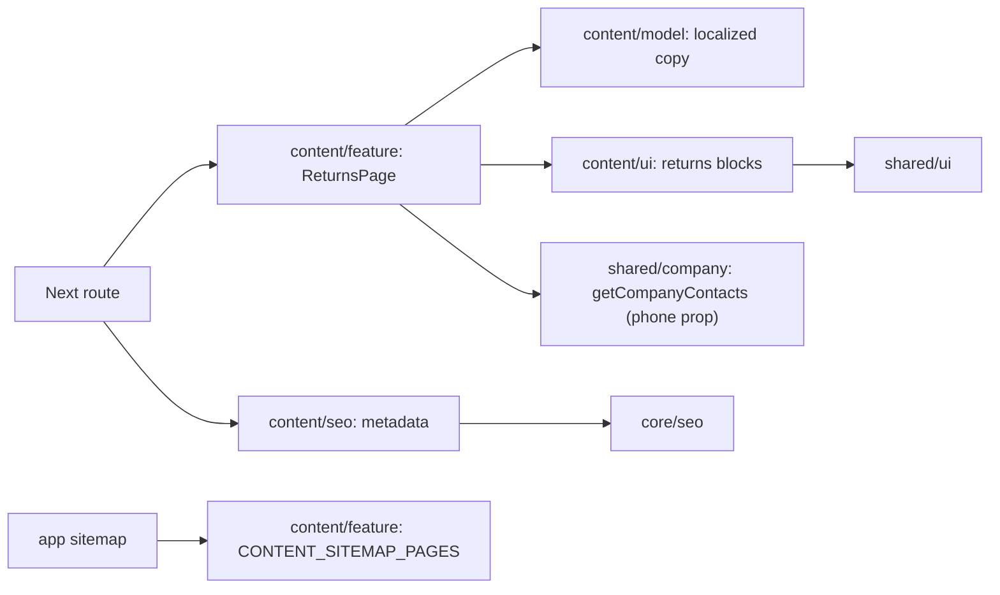

# Returns and exchanges

**Route:** `/{locale}/returns-exchanges` (`uk`, `ru`). [SDD and approved concept](../../specs/site/content/001-returns-exchanges/README.md).

The page presents two compact conditions/warranty panels, a three-step request process, important notes and the configured company phone. The full existing policy and three native FAQ disclosures remain in server HTML. It uses the current shell, light/dark tokens and responsive stacking; it adds no API, return form or client state.

## Architecture



Copy was transferred from Storefront returns translations; Angular is not a runtime dependency. The root layout owns Organization JSON-LD and the existing preview indexing gate. The page has self canonical, reciprocal language alternates and both localized sitemap entries.

## Code structure

```text
apps/site/src/app/[locale]/(content)/returns-exchanges/page.tsx # thin localized route
libs/site/content/
├── model/src/lib/
│   ├── returns-types.ts          # typed content contract
│   ├── returns-policy-copy.ts    # complete existing uk/ru policy
│   ├── returns-summary-copy.ts   # localized summary text
│   ├── returns-policy-sections.ts # typed complete policy mapping
│   └── returns-dictionary.ts     # dictionary assembly and sourced FAQ
├── ui/src/lib/returns/
│   ├── returns-content.tsx       # content composition
│   ├── returns-header.tsx        # breadcrumb, title and section navigation
│   ├── returns-panels.tsx        # conditions and warranty label/value panels
│   ├── returns-process.tsx       # ordered three-step process
│   ├── returns-support.tsx       # notes and support layout
│   ├── returns-contact.tsx       # configured telephone panel
│   ├── returns-policy.tsx        # complete policy sections
│   └── returns-faq.tsx           # native disclosure
├── feature/src/lib/
│   ├── returns-page.tsx          # dictionary and UI composition
│   └── content-sitemap.ts        # public static content descriptors
└── seo/src/lib/returns-metadata.ts # domain metadata through core builder
```

## Tests

- `site-content-ui`: `npx nx run site-content-ui:vite:test -- --run src/lib/returns/returns-content.spec.tsx` — both languages, headings, anchors, terms/process, phone, full policy and native FAQ.
- `site-content-seo`: `npx nx run site-content-seo:vite:test -- --run src/lib/returns-metadata.spec.ts` — metadata, canonical, alternates and indexing.
- `site-content-feature`: `npx nx run site-content-feature:vite:test -- --run src/lib/content-sitemap.spec.ts` — localized returns URLs and reciprocal alternates.

Static model copy is exercised through component coverage. Browser/rendered HTML/build verification is not performed without separate permission; current evidence lives in SDD tasks.

- Model policy completeness: node node_modules/vitest/vitest.mjs run --config libs/site/content/model/vite.config.mts src/lib/returns-policy-sections.spec.ts. The test checks every source policy heading and sentence in both languages.

[Responsibility audit and refactoring](../../specs/site/content/001-returns-exchanges/code-audit/audit.md).
