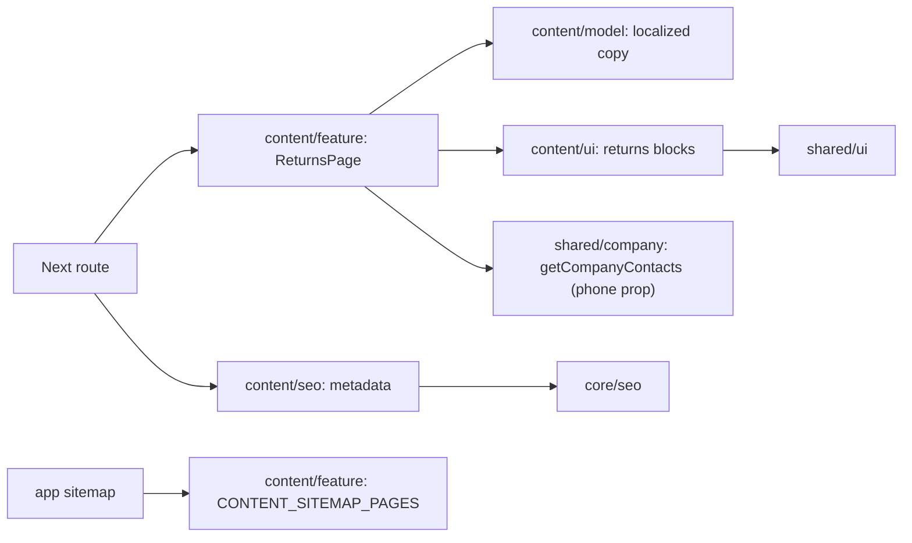

# Returns and exchanges

**Route:** `/{locale}/returns-exchanges` (`uk`, `ru`). [SDD and approved concept](../../specs/site/content/001-returns-exchanges/README.md).

**Text source (2026-11-04):** the legal body is the published edition from the admin ([Admin site documents](../admin/documents.md)), read by `getLegalDocument(locale, 'returns-policy')` in `content/data-access` (cache tag `content:document:returns-policy`, ten-minute life) and turned into sections by `buildLegalDocument` in `content/model`: H2 headings become sections and contents, `{site}`, `{email}` and `{phone}` are filled from the site host and saved contacts. Nothing published answers 404; an API failure is an error, never an empty page. Page chrome stays in code. The summary panels, process and FAQ stay in code; the full rules section shows the edition title and date, with its headings one level lower.

The page presents two compact conditions/warranty panels, a three-step request process, important notes and the configured company phone. The full existing policy and three native FAQ disclosures remain in server HTML. It uses the current shell, light/dark tokens and responsive stacking; it adds no API, return form or client state.

## Architecture



Copy was transferred from Storefront returns translations; Angular is not a runtime dependency. The root layout owns Organization JSON-LD and the existing preview indexing gate. The page has self canonical, reciprocal language alternates and both localized sitemap entries.

## Code structure

```text
apps/site/
  src/app/[locale]/(content)/returns-exchanges/
    page.tsx                     # thin localized route
libs/site/content/
  feature/src/lib/returns/
    returns-page.tsx             # dictionary and UI composition
  feature/src/lib/sitemap/
    content-sitemap.ts           # public static content descriptors
  model/src/lib/copy/returns/
    returns-types.ts             # typed content contract
    returns-summary-copy.ts      # localized summary text and FAQ
    returns-dictionary.ts        # dictionary assembly
  seo/src/lib/metadata/returns/
    returns-metadata.ts          # domain metadata through core builder
  ui/src/lib/returns/
    returns-content.tsx          # content composition
    returns-header.tsx           # breadcrumb, title and section navigation
  ui/src/lib/returns/sections/
    returns-panels.tsx           # conditions and warranty label/value panels
    returns-process.tsx          # ordered three-step process
    returns-support.tsx          # notes and support layout
    returns-contact.tsx          # configured telephone panel
    returns-policy.tsx           # published full rules
    returns-faq.tsx              # native disclosure
```

## Tests

- `site-content-ui`: `npx nx run site-content-ui:vite:test -- --run src/lib/returns/returns-content.spec.tsx` — both languages, headings, anchors, terms/process, phone, full policy and native FAQ.
- `site-content-seo`: `npx nx run site-content-seo:vite:test -- --run src/lib/metadata/returns/returns-metadata.spec.ts` — metadata, canonical, alternates and indexing.
- `site-content-feature`: `npx nx run site-content-feature:vite:test -- --run src/lib/sitemap/content-sitemap.spec.ts` — localized returns URLs and reciprocal alternates.

Static model copy is exercised through component coverage. Browser/rendered HTML/build verification is not performed without separate permission; current evidence lives in SDD tasks.

[Responsibility audit and refactoring](../../specs/site/content/001-returns-exchanges/code-audit/audit.md).
