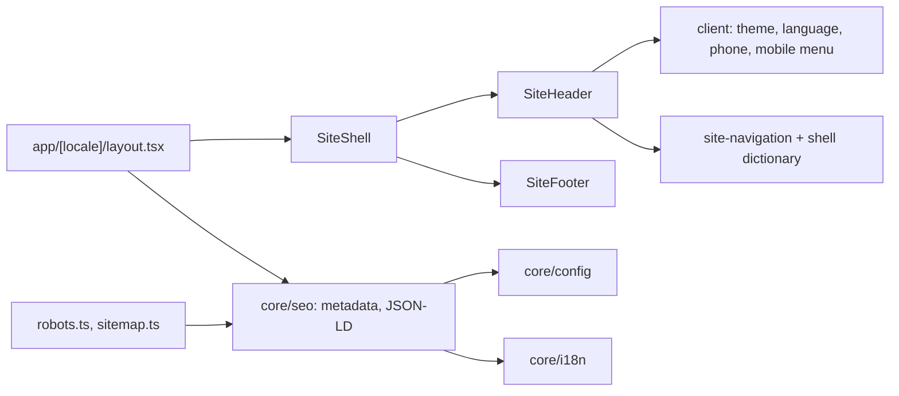

# Site shell

**Entry point:** [locale layout](../../../apps/site/src/app/[locale]/layout.tsx) wraps every `/uk` and `/ru` page in [SiteShell](../../../libs/site/core/shell/src/lib/layout/site-shell.tsx). The home page is described in [Site home page](home.md).

- **Header:** top bar (city on the left, information pages centered against the full header, UA/RU and an uncaptioned sun/moon theme switch on the right; centered second-row links below xl), main bar (logo, «Каталог» mega menu from the [catalog](catalog.md) or the fixed dropdown, search form to `/{locale}/search?q=`, phone copy with Telegram/Viber/map, a call button below xl, and the cart), category bar (sections, cooperation), mobile sheet menu. There is no regions menu and no cabinet or login link until those features exist (owner decision 2026-11-04); old `/{locale}/region/*` addresses redirect permanently to `/{locale}/wholesale`, and the old `/{locale}/login` and `/{locale}/cabinet/*` to the localized home. On desktop only the category bar stays on screen while scrolling ([collapsing-header.tsx](../../../libs/site/core/shell/src/lib/header/frame/collapsing-header.tsx)); once the upper rows are gone, search and cart icons fade in, and the search icon opens the search form under the bar. Phones keep the whole header. The category row and phone menu list the live sections passed as `catalogNavigation`, else the fixed sections from [site-navigation.ts](../../../libs/site/core/shell/src/lib/navigation/site-navigation.ts); text from the [shell dictionary](../../../libs/site/core/shell/src/lib/i18n/shell-dictionary.ts).
- **Footer:** catalog (the same live sections as the header, else the fixed fallback), company, and buyer links; phone, email, city, messengers. In the top bar, mobile menu and footer, the company link targets `/{locale}#about-company` on the home page. Former `/{locale}/about-company` URLs redirect permanently to the localized home.
- **Themes and languages:** light and dark through `next-themes`; the accessible sun/moon switch reflects the resolved system theme, selects its opposite on activation, and waits for hydration before enabling. The knob moves over 180ms unless reduced motion is enabled; `LocaleSwitch` links to the same page in the other language.
- **SEO baseline:** root and page metadata, self canonical, `hreflang` with `x-default`, Organization and WebSite JSON-LD, static `robots.txt` (it points to `sitemap.xml` and the product sitemap index, so it never depends on the API) and `sitemap.xml`, all from [core/seo](../../../libs/site/core/seo/src/index.ts). Indexing is off until `SITE_ENV=production` and `SITE_INDEXING=true`. The layout also adds the Google/Bing verification meta tags and GA4/GTM scripts from the admin [«Налаштування SEO сайту»](../admin/seo-settings.md); an empty code adds nothing.
- **500:** when page data fails, [locale error](../../../apps/site/src/app/[locale]/error.tsx) renders `ErrorView` inside the frame.
- **404:** unmatched URLs and paths without a locale (rewritten by [proxy](../../../apps/site/src/proxy.ts)) get [global-not-found](../../../apps/site/src/app/global-not-found.tsx); `notFound()` from a page renders [locale not-found](../../../apps/site/src/app/[locale]/not-found.tsx), which reads the locale with `next/root-params`.
- **API client:** [siteApiGet](../../../libs/site/shared/api-client/src/lib/site-api.ts) is a plain typed fetch; domain `data-access` libraries cache it with `'use cache'`.
- **Footer year:** a cached component, so the footer stays in the prerendered page.

## Architecture



## Code structure

```text
apps/site/src/app/
├── [locale]/layout.tsx  # html lang, fonts, theme, shell, root metadata
├── [locale]/page.tsx  # home route (see home.md)
├── [locale]/not-found.tsx, global-not-found.tsx  # 404, both render NotFoundView from the shell
├── [locale]/error.tsx  # 500 inside the frame, renders ErrorView
├── robots.ts, sitemap.ts  # crawling files
└── global.css, fonts.ts  # design tokens, Onest and JetBrains Mono

libs/site/core/shell/src/lib/
├── layout/site-shell.tsx  # frame
├── header/  # site-header, collapsing sticky header, search form, call and cart actions, compact actions
│   ├── bars/  # top, main, and category rows
│   └── menus/  # details dropdown, catalog menu, mobile sheet
├── not-found/not-found-view.tsx  # 404 message per language
├── error/error-view.tsx  # client: data failure message with retry
├── footer/  # site-footer.tsx, copyright-year.tsx (cached)
├── controls/  # client islands: theme, language, phone copy; messenger links
├── navigation/  # site-navigation.ts locale-free paths and fallback sections; catalog-navigation.ts prop type
└── i18n/shell-dictionary.ts  # uk and ru text

libs/site/core/{config,i18n,seo,revalidation}/  # environment and company facts, locales and paths, SEO builders, cache refresh request
libs/site/shared/{ui,api-client}/  # shadcn primitives, server-only fetch
```

## Tests

Localized company links in the top bar, open mobile menu and footer are covered by `site-shell.spec.tsx` (both languages).

Top bar/switch specification and evidence: [001 — top bar controls](../../specs/site/shell/001-top-bar-controls/README.md). `controls/theme-toggle.spec.tsx` covers both theme states, switching, system preference updates and server markup.

- All site libraries: `npm run test:site`.
- One library: `npx nx run site-core-shell:vite:test -- --run` (also `site-core-config`, `site-core-i18n`, `site-core-seo`, `site-shared-ui`, `site-shared-api-client`).
- App: `npx nx run site:typecheck`, `npx nx run site:lint`, `npx nx run site:build`.

Related: [site architecture](../../architecture/site/README.md), [migration plan](../../specs/site/migration/README.md).
