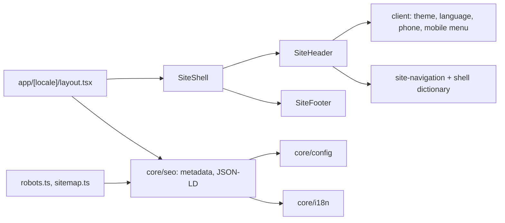

# Site shell

**Entry point:** [locale layout](../../../apps/site/src/app/[locale]/layout.tsx) wraps every `/uk` and `/ru` page in [SiteShell](../../../libs/site/core/shell/src/lib/site-shell.tsx). The home page is described in [Site home page](home.md).

- **Header:** top bar (city, information pages, UA/RU, theme), main bar (logo, «Каталог» dropdown, search form, phone copy with Telegram/Viber/map, cabinet and cart links), category bar (sections, regions, cooperation), mobile sheet menu. Links use the current storefront URLs from [site-navigation.ts](../../../libs/site/core/shell/src/lib/navigation/site-navigation.ts); text from the [shell dictionary](../../../libs/site/core/shell/src/lib/i18n/shell-dictionary.ts).
- **Footer:** catalog, company, and buyer links; phone, email, city, messengers.
- **Themes and languages:** light and dark through `next-themes`; `LocaleSwitch` links to the same page in the other language.
- **SEO baseline:** root and page metadata, self canonical, `hreflang` with `x-default`, Organization and WebSite JSON-LD, `robots.txt` and `sitemap.xml`, all from [core/seo](../../../libs/site/core/seo/src/index.ts). Indexing is off until `SITE_ENV=production` and `SITE_INDEXING=true`.
- **404:** unmatched URLs and paths without a locale (rewritten by [proxy](../../../apps/site/src/proxy.ts)) get [global-not-found](../../../apps/site/src/app/global-not-found.tsx); `notFound()` from a page renders [locale not-found](../../../apps/site/src/app/[locale]/not-found.tsx), which reads the locale with `next/root-params`.
- **API client:** [siteApiGet](../../../libs/site/shared/api-client/src/lib/site-api.ts) is a plain typed fetch; domain `data-access` libraries cache it with `'use cache'`.
- **Footer year:** a cached component, so the footer stays in the prerendered shell under Cache Components.

## Architecture



## Code structure

```text
apps/site/src/app/
├── [locale]/layout.tsx  # html lang, fonts, theme, shell, root metadata
├── [locale]/page.tsx  # home route (see home.md)
├── [locale]/not-found.tsx, global-not-found.tsx  # 404, both render NotFoundView from the shell
├── robots.ts, sitemap.ts  # crawling files
└── global.css, fonts.ts  # design tokens, Onest and JetBrains Mono

libs/site/core/shell/src/lib/
├── site-shell.tsx  # frame
├── header/  # site-header, search form, cabinet and cart actions
│   ├── bars/  # top, main, and category rows
│   └── menus/  # details dropdown, catalog and regions menus, mobile sheet
├── not-found/not-found-view.tsx  # 404 message per language
├── footer/  # site-footer.tsx, copyright-year.tsx (cached)
├── controls/  # client islands: theme, language, phone copy; messenger links
├── navigation/site-navigation.ts  # locale-free paths
└── i18n/shell-dictionary.ts  # uk and ru text

libs/site/core/{config,i18n,seo}/  # environment and company facts, locales and paths, SEO builders
libs/site/shared/{ui,api-client}/  # shadcn primitives, server-only fetch
```

## Tests

- All site libraries: `npm run test:site`.
- One library: `npx nx run site-core-shell:vite:test -- --run` (also `site-core-config`, `site-core-i18n`, `site-core-seo`, `site-shared-ui`, `site-shared-api-client`).
- App: `npx nx run site:typecheck`, `npx nx run site:lint`, `npx nx run site:build`.

Related: [site architecture](../../architecture/site/README.md), [migration plan](../../specs/site/migration/README.md).
