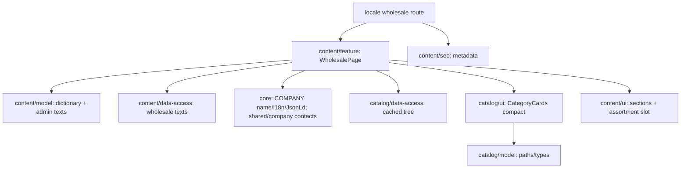

# Site wholesale cooperation

**Entry point:** [wholesale route](../../../apps/site/src/app/[locale]/%28content%29/wholesale/page.tsx) renders [WholesalePage](../../../libs/site/content/feature/src/lib/wholesale/wholesale-page.tsx) at `/uk/wholesale` and `/ru/wholesale`. [Approved SDD](../../specs/site/content/001-wholesale/README.md).

- Product-specific H1, real hardware category cards, confirmed Class Kedr facts, three order steps, visible FAQ and manager contact. Wholesale prices and specific terms are learned from the manager; no new purchase thresholds or promises.
- Managers edit the page texts in the [admin «Співпраця»](../admin/wholesale-content.md). `getWholesaleTexts(locale)` in `content/data-access` reads `GET /api/content/{lang}/wholesale` (cache tags `content`, `content:wholesale`, ten-minute life) and `applyWholesaleTexts` puts them over the code dictionary; on an API failure, or texts without exactly three steps or without questions, the page keeps the code copy. More than three questions reuse the three FAQ icons in order.
- `content/model` owns typed UK/RU copy and the fallback. `getCompanyContacts()` ([company contacts](company-contacts.md)) owns phone, city and messenger links; feature projects them into presentation props.
- Async feature reuses cached `getCatalogTree`, excludes the doors root and renders `CategoryCards variant="compact"`. Names/slugs/order and local photos remain owned by the catalog. Partial data stays partial; null/empty/doors-only gives a localized catalog/manager fallback without losing the offer, company, steps or FAQ.
- `content/ui` receives a server ReactNode/null assortment slot. It has no catalog/API dependency or new client state. Existing shell owns the only main, header/footer, theme/language and Organization.
- Domain metadata delegates to core/seo. The page adds only BreadcrumbList; sitemap expands one descriptor to both locales without a fabricated modification date. Existing indexing gate is preserved.
- Existing catalog card defaults retain counts and child links; compact omits those details and uses a two-column phone / three-column desktop grid.

## Structure diagram



Only the documented content-feature → catalog data-access/model/ui cross-domain edges are allowed; UI/model and feature-to-feature restrictions remain.

## Code structure

```text
apps/site/src/app/[locale]/(content)/wholesale/page.tsx  # thin route + metadata
libs/site/content/
├── model/src/lib/wholesale-types.ts, wholesale-dictionary.ts  # presentation/copy, code fallback
├── model/src/lib/wholesale-texts.ts       # admin texts over the dictionary
├── data-access/src/lib/wholesale/         # cached API read, mapper, cache tags
├── ui/src/lib/wholesale/
│   ├── wholesale-content.tsx        # page composition
│   ├── wholesale-hero.tsx           # offer/contact panel
│   ├── wholesale-assortment.tsx     # slot/fallback
│   ├── wholesale-company.tsx        # sourced facts/help
│   ├── wholesale-steps.tsx          # order sequence
│   ├── wholesale-faq.tsx            # visible Q/A
│   └── wholesale-contact.tsx        # final contact/useful links
├── seo/src/lib/wholesale-metadata.ts, wholesale-json-ld.ts
└── feature/src/lib/wholesale-page.tsx, content-sitemap.ts
libs/site/catalog/ui/src/lib/category-cards/category-cards.tsx  # optional compact variant
tools/architecture/project-boundary-rules.mjs                 # narrow allowed flow
```

Public APIs are exported from each existing library index. Operations `getPublicWholesalePage` (content/data-access) and `getCategoryTree` (catalog/data-access) stay behind their mappers.

## Tests

Focused commands, not a request to run all targets:

```text
npx nx run site-content-ui:vite:test -- --run wholesale
npx nx run site-content-seo:vite:test -- --run wholesale
npx nx run site-content-feature:vite:test -- --run wholesale-page content-sitemap
npx nx run site-content-model:vite:test -- --run wholesale-texts
npx nx run site-content-data-access:vite:test -- --run wholesale-loader
npx nx run site-catalog-ui:vite:test -- --run src/lib/category-cards/category-cards.spec.tsx
```

Current evidence: UI 8, SEO 7, feature/sitemap 18, catalog cards 3 tests passed. Boundaries: 22 fixtures and actual graph 103 projects passed; site:typecheck passed. See [verification](../../specs/site/content/001-wholesale/verification/seo-verification.md) for exact scope/commands and [local review](../../specs/site/content/001-wholesale/verification/local-review.md).

Build, real HTTP/head, browser/manual/visual/E2E and deployment were not run. Responsive/theme integration is source-reviewed rather than pixel-verified.
