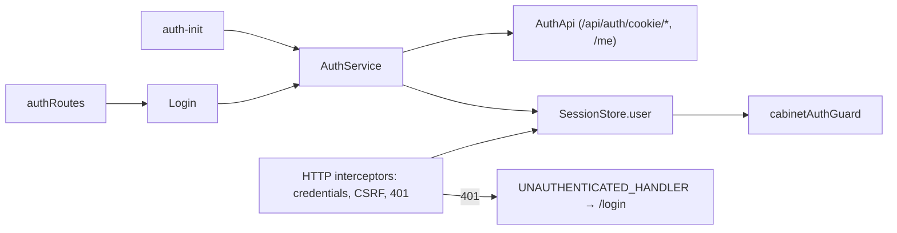

# Storefront Sign-in

**Entry point:** [authRoutes](../../../../libs/storefront/feature/auth/src/lib/lib.routes.ts) opens `/login`.

- [Login](../../../../libs/storefront/feature/auth/src/lib/pages/login/login.ts) validates email/password, calls `AuthService` from [shared/auth](../../../../libs/shared/auth/src/index.ts), and takes the user to the cabinet or a validated `returnUrl`.
- The session is an HttpOnly cookie (`POST /api/auth/cookie/login`); no token is kept in the browser. On start, [auth-init](../../../../apps/storefront/src/app/auth/auth-init.provider.ts) calls `AuthService.restoreSession()` (`GET /api/auth/session/me`) and fills `SessionStore.user`.
- [csrfInterceptor](../../../../libs/shared/auth/src/lib/interceptors/csrf.interceptor.ts) adds `X-CSRF-Token` to every non-GET request. On a `401` outside `/api/auth/`, [unauthorizedInterceptor](../../../../libs/shared/auth/src/lib/interceptors/unauthorized.interceptor.ts) clears the session and calls `UNAUTHENTICATED_HANDLER`; the [app handler](../../../../apps/storefront/src/app/auth/unauthenticated-handler.provider.ts) opens the localized login page with `returnUrl` when the user was in the cabinet.
- Public catalog, checkout, and content pages work for guests. The [cabinet](cabinet.md) is a protected session consumer. Contract: [Session](../../../contracts/identity/session.md).

## Architecture



## Code structure

```text
libs/shared/auth/src/lib/
├── data-access/auth.api.ts  # cookie login/logout, me
├── services/auth.service.ts  # login, logout, restoreSession
├── state/session.store.ts  # signed-in user
└── interceptors/  # credentials, CSRF, unauthorized

apps/storefront/src/app/auth/
├── auth-init.provider.ts  # restore the session on start
└── unauthenticated-handler.provider.ts  # localized login redirect

libs/storefront/feature/auth/src/lib/
├── pages/login/login.ts  # page and UI composition
└── lib.routes.ts  # feature routes
```

## Tests

No automated tests cover this feature yet; the storefront auth libraries have no test target. Checked with the storefront TypeScript build (`npx tsc -p apps/storefront/tsconfig.app.json --noEmit`) and lint.
