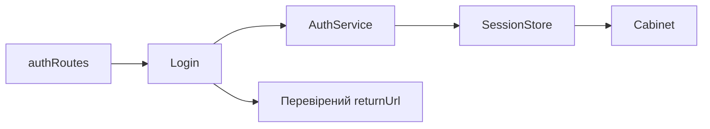

# Вхід Storefront

**Вхід:** [authRoutes](../../../../libs/storefront/feature/auth/src/lib/lib.routes.ts) відкриває `/login`.

- [Login](../../../../libs/storefront/feature/auth/src/lib/pages/login/login.ts) валідує email/пароль, викликає `AuthService` зі [shared/auth](../../../../libs/shared/auth/src/index.ts), читає `SessionStore` і переводить користувача до кабінету або перевіреного `returnUrl`.
- Контракт і cookie/refresh правила — [Session](../../../contracts/identity/session.md). Захищений споживач сесії — [кабінет](cabinet.md).

## Схема будови



## Структура в коді

Фактичні точки входу й основні файли фічі (інші файли цих каталогів тут не перелічено):

```text
libs/shared/auth/
└── src/index.ts  # публічний API бібліотеки

libs/storefront/feature/auth/
└── src/lib/
    ├── pages/login/login.ts  # сторінка та композиція UI
    └── lib.routes.ts  # маршрути фічі
```
