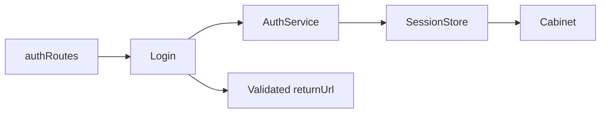

# Storefront Sign-in

**Entry point:** [authRoutes](../../../../libs/storefront/feature/auth/src/lib/lib.routes.ts) opens `/login`.

- [Login](../../../../libs/storefront/feature/auth/src/lib/pages/login/login.ts) validates email/password, calls `AuthService` from [shared/auth](../../../../libs/shared/auth/src/index.ts), reads `SessionStore`, and takes the user to the cabinet or a validated `returnUrl`.
- The contract and cookie/refresh rules are in [Session](../../../contracts/identity/session.md). The [cabinet](cabinet.md) is a protected session consumer.

## Architecture



## Code structure

Actual entry points and primary feature files (other files in these directories are omitted):

```text
libs/shared/auth/
└── src/index.ts  # library public API

libs/storefront/feature/auth/
└── src/lib/
    ├── pages/login/login.ts  # page and UI composition
    └── lib.routes.ts  # feature routes
```

## Tests

No automated tests cover this feature yet.
