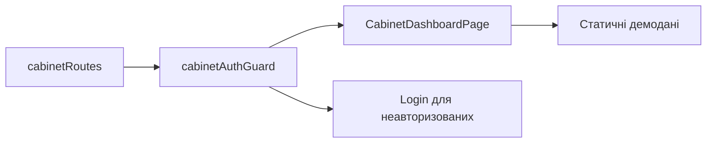

# Кабінет Storefront

**Вхід:** [cabinetRoutes](../../../../libs/storefront/feature/cabinet/src/lib/lib.routes.ts) відкриває `/cabinet/dashboard` через `CabinetSidebar`.

- [cabinetAuthGuard](../../../../libs/storefront/feature/cabinet/src/lib/guards/cabinet-auth.guard.ts) обмежує маршрут за станом сесії; неавторизований користувач переходить до [входу](auth.md).
- [CabinetDashboardPage](../../../../libs/storefront/feature/cabinet/src/lib/pages/cabinet-dashboard/cabinet-dashboard.page.ts) показує демонстраційні статичні дані та quick actions; API-дані замовлень тут поки не підключені. Додаткові підмаршрути не налаштовані.

## Схема будови



## Структура в коді

Фактичні точки входу й основні файли фічі (інші файли цих каталогів тут не перелічено):

```text
libs/storefront/feature/cabinet/
└── src/lib/
    ├── guards/cabinet-auth.guard.ts  # захист маршруту
    ├── pages/cabinet-dashboard/cabinet-dashboard.page.ts  # сторінка та композиція UI
    └── lib.routes.ts  # маршрути фічі
```
