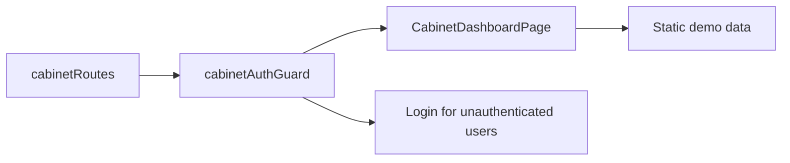

# Storefront Cabinet

**Entry point:** [cabinetRoutes](../../../../libs/storefront/feature/cabinet/src/lib/lib.routes.ts) opens `/cabinet/dashboard` through `CabinetSidebar`.

- [cabinetAuthGuard](../../../../libs/storefront/feature/cabinet/src/lib/guards/cabinet-auth.guard.ts) restricts the route based on session state; an unauthenticated user is sent to [sign-in](auth.md).
- [CabinetDashboardPage](../../../../libs/storefront/feature/cabinet/src/lib/pages/cabinet-dashboard/cabinet-dashboard.page.ts) shows static demo data and quick actions; order API data is not connected here yet. No additional child routes are configured.

## Architecture



## Code structure

Actual entry points and primary feature files (other files in these directories are omitted):

```text
libs/storefront/feature/cabinet/
└── src/lib/
    ├── guards/cabinet-auth.guard.ts  # route protection
    ├── pages/cabinet-dashboard/cabinet-dashboard.page.ts  # page and UI composition
    └── lib.routes.ts  # feature routes
```
