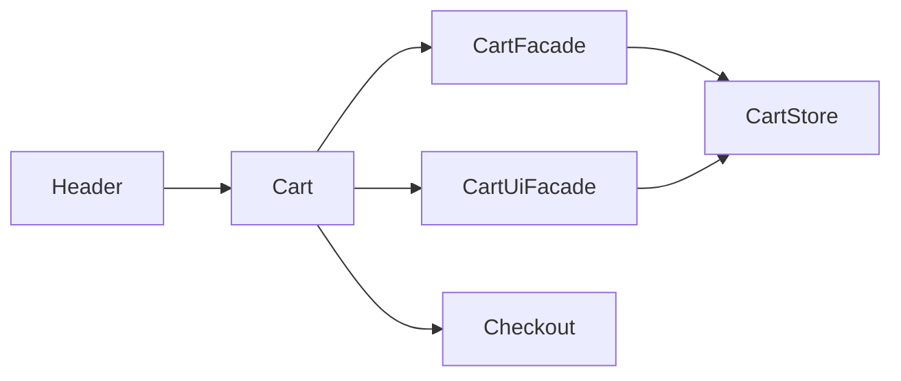

# Кошик Storefront

**Вхід:** [Cart](../../../../libs/storefront/feature/cart/src/lib/cart/cart.ts) імпортує [header](../../../../libs/storefront/shell/src/lib/header/header.ts); окремого маршруту кошика немає.

- [CartFacade](../../../../libs/storefront/data-access/src/lib/cart/state/cart.facade.ts) володіє рядками й підсумком, [CartUiFacade](../../../../libs/storefront/data-access/src/lib/cart/state/cart-ui.facade.ts) — відкриттям панелі; [CartStore](../../../../libs/storefront/data-access/src/lib/cart/state/cart.store.ts) зберігає стан.
- Компонент змінює кількість і веде до локалізованого [checkout](checkout.md). Товари додаються з [каталогу](catalog.md).

## Схема будови



## Структура в коді

Фактичні точки входу й основні файли фічі (інші файли цих каталогів тут не перелічено):

```text
libs/storefront/data-access/
└── src/lib/cart/state/
    ├── cart-ui.facade.ts  # стан і взаємодія з даними
    ├── cart.facade.ts  # стан і взаємодія з даними
    └── cart.store.ts  # стан і взаємодія з даними

libs/storefront/feature/cart/
└── src/lib/cart/cart.ts  # реалізація фічі

libs/storefront/shell/
└── src/lib/header/header.ts  # реалізація фічі
```
