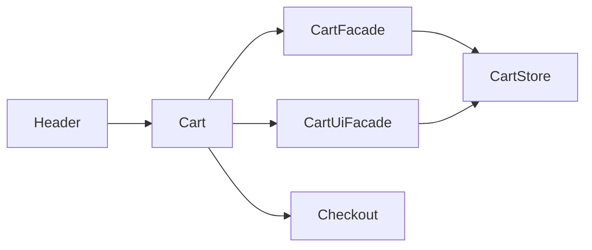

# Storefront Cart

**Entry point:** [Cart](../../../../libs/storefront/feature/cart/src/lib/cart/cart.ts) is imported by the [header](../../../../libs/storefront/shell/src/lib/header/header.ts); there is no separate cart route.

- [CartFacade](../../../../libs/storefront/data-access/src/lib/cart/state/cart.facade.ts) owns line items and totals; [CartUiFacade](../../../../libs/storefront/data-access/src/lib/cart/state/cart-ui.facade.ts) controls opening the panel; [CartStore](../../../../libs/storefront/data-access/src/lib/cart/state/cart.store.ts) stores the state.
- The component changes quantities and links to localized [checkout](checkout.md). Products are added from the [catalog](catalog.md).

## Architecture



## Code structure

Actual entry points and primary feature files (other files in these directories are omitted):

```text
libs/storefront/data-access/
└── src/lib/cart/state/
    ├── cart-ui.facade.ts  # state and data interaction
    ├── cart.facade.ts  # state and data interaction
    └── cart.store.ts  # state and data interaction

libs/storefront/feature/cart/
└── src/lib/cart/cart.ts  # feature implementation

libs/storefront/shell/
└── src/lib/header/header.ts  # feature implementation
```

## Tests

Spec files sit next to the code in each project. Focused runs:

- `libs/storefront/data-access` (3 spec files): `npx nx run storefront-data-access:vite:test -- --run`

Without tests: `cart`, `storefront-shell`.
