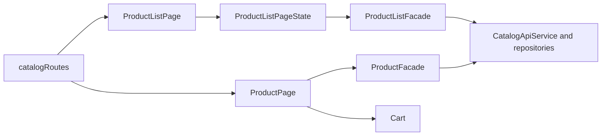

# Storefront Product Catalog

**Entry point:** [catalogRoutes](../../../../libs/storefront/feature/catalog/src/lib/lib.routes.ts) connects the all-products list, category product list, and product page.

- [ProductListPage](../../../../libs/storefront/feature/catalog/src/lib/pages/product-list/product-list.page.ts) composes category navigation, filters, and results; [ProductListPageState](../../../../libs/storefront/feature/catalog/src/lib/pages/product-list/product-list.page-state.ts) and [ProductListFacade](../../../../libs/storefront/data-access/src/lib/catalog/state/product-list/product-list.facade.ts) manage the query, pages, and refresh after a language change.
- [ProductPage](../../../../libs/storefront/feature/catalog/src/lib/pages/product-page/product-page.ts) reads a product by slug through [ProductFacade](../../../../libs/storefront/data-access/src/lib/catalog/state/product/product.facade.ts). [CatalogApiService](../../../../libs/storefront/data-access/src/lib/catalog/api/catalog-api.service.ts) and repositories isolate HTTP; the [public products contract](../../../contracts/catalog/public-products.md) describes consumer decisions.
- Direct `/uk/catalog/product/:productSlug` and `/ru/catalog/product/:productSlug` routes use `RenderMode.Client`. For these HTML requests, the [Cloudflare Worker](../../../../apps/storefront/public/_worker.js) serves `/index.csr.html` while preserving the URL: the published `/404.html` contains a meta refresh to `/uk` and may be returned by Pages with status `200`. After the shell loads, the Angular router reads the slug and locale; the product API remains a separate request. Review this Worker rule if product pages move to SSR or prerendering.
- Purchasing goes through the [cart](cart.md) and [checkout](checkout.md).

## Architecture



## Code structure

Actual entry points and primary feature files (other files in these directories are omitted):

```text
libs/storefront/data-access/
└── src/lib/catalog/
    ├── api/catalog-api.service.ts  # API request
    └── state/
        ├── product/product.facade.ts  # state and data interaction
        └── product-list/product-list.facade.ts  # state and data interaction

libs/storefront/feature/catalog/
└── src/lib/
    ├── pages/
    │   ├── product-list/
    │   │   ├── product-list.page-state.ts  # page and UI composition
    │   │   └── product-list.page.ts  # page and UI composition
    │   └── product-page/product-page.ts  # page and UI composition
    └── lib.routes.ts  # feature routes
```
