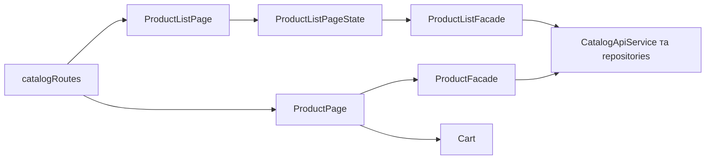

# Каталог товарів Storefront

**Вхід:** [catalogRoutes](../../../../libs/storefront/feature/catalog/src/lib/lib.routes.ts) підключає списки всіх товарів, список за категорією й сторінку товару.

- [ProductListPage](../../../../libs/storefront/feature/catalog/src/lib/pages/product-list/product-list.page.ts) складає навігацію категорій, фільтри й результати; [ProductListPageState](../../../../libs/storefront/feature/catalog/src/lib/pages/product-list/product-list.page-state.ts) та [ProductListFacade](../../../../libs/storefront/data-access/src/lib/catalog/state/product-list/product-list.facade.ts) керують запитом, сторінками й оновленням після зміни мови.
- [ProductPage](../../../../libs/storefront/feature/catalog/src/lib/pages/product-page/product-page.ts) читає товар за slug через [ProductFacade](../../../../libs/storefront/data-access/src/lib/catalog/state/product/product.facade.ts). [CatalogApiService](../../../../libs/storefront/data-access/src/lib/catalog/api/catalog-api.service.ts) і репозиторії ізолюють HTTP; [контракт public products](../../../contracts/catalog/public-products.md) описує consumer-рішення.
- Перехід до покупки проходить через [кошик](cart.md) та [checkout](checkout.md).

## Схема будови



## Структура в коді

Фактичні точки входу й основні файли фічі (інші файли цих каталогів тут не перелічено):

```text
libs/storefront/data-access/
└── src/lib/catalog/
    ├── api/catalog-api.service.ts  # запит до API
    └── state/
        ├── product/product.facade.ts  # стан і взаємодія з даними
        └── product-list/product-list.facade.ts  # стан і взаємодія з даними

libs/storefront/feature/catalog/
└── src/lib/
    ├── pages/
    │   ├── product-list/
    │   │   ├── product-list.page-state.ts  # сторінка та композиція UI
    │   │   └── product-list.page.ts  # сторінка та композиція UI
    │   └── product-page/product-page.ts  # сторінка та композиція UI
    └── lib.routes.ts  # маршрути фічі
```
