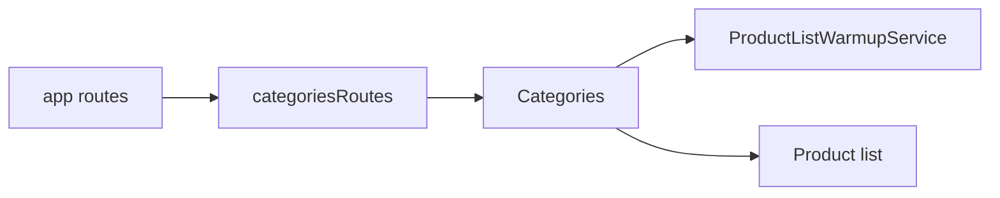

# Storefront Categories

**Entry point:** [categoriesRoutes](../../../../libs/storefront/feature/categories/src/lib/lib.routes.ts) is connected to [app routes](../../../../apps/storefront/src/app/app.routes.ts) at localized `/` and `/categories`.

- [Categories](../../../../libs/storefront/feature/categories/src/lib/page/categories.ts) composes door and hardware sections from catalog constants and localized labels; links open the [product list](catalog.md).
- [ProductListWarmupService](../../../../libs/storefront/data-access/src/lib/catalog/state/product-list/product-list-warmup.service.ts) prepares list data; this page does not own checkout or cart state.

## Architecture



## Code structure

Actual entry points and primary feature files (other files in these directories are omitted):

```text
apps/storefront/src/app/
└── app.routes.ts  # feature routes

libs/storefront/data-access/
└── src/lib/catalog/state/product-list/product-list-warmup.service.ts  # state and data interaction

libs/storefront/feature/categories/
└── src/lib/
    ├── page/categories.ts  # page and UI composition
    └── lib.routes.ts  # feature routes
```

## Tests

Spec files sit next to the code in each project. Focused runs:

- `libs/storefront/data-access` (3 spec files): `npx nx run storefront-data-access:vite:test -- --run`

Without tests: `storefront`, `storefront-feature-categories`.
