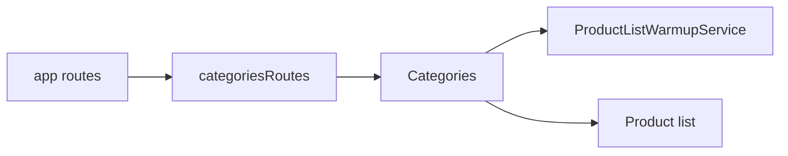

# Категорії Storefront

**Вхід:** [categoriesRoutes](../../../../libs/storefront/feature/categories/src/lib/lib.routes.ts) підключено до [app routes](../../../../apps/storefront/src/app/app.routes.ts) за локалізованими `/` та `/categories`.

- [Categories](../../../../libs/storefront/feature/categories/src/lib/page/categories.ts) складає розділи дверей і фурнітури з каталогових констант та локалізованих підписів; посилання ведуть до [списку товарів](catalog.md).
- [ProductListWarmupService](../../../../libs/storefront/data-access/src/lib/catalog/state/product-list/product-list-warmup.service.ts) готує дані списку; ця сторінка не володіє checkout або cart state.

## Схема будови



## Структура в коді

Фактичні точки входу й основні файли фічі (інші файли цих каталогів тут не перелічено):

```text
apps/storefront/src/app/
└── app.routes.ts  # маршрути фічі

libs/storefront/data-access/
└── src/lib/catalog/state/product-list/product-list-warmup.service.ts  # стан і взаємодія з даними

libs/storefront/feature/categories/
└── src/lib/
    ├── page/categories.ts  # сторінка та композиція UI
    └── lib.routes.ts  # маршрути фічі
```
