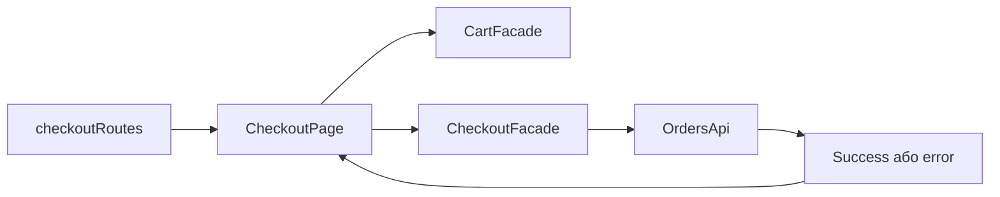

# Оформлення Storefront

**Вхід:** [checkoutRoutes](../../../../libs/storefront/feature/checkout/src/lib/lib.routes.ts) відкриває `/checkout`.

- [CheckoutPage](../../../../libs/storefront/feature/checkout/src/lib/page/checkout-page.ts) читає [CartFacade](../../../../libs/storefront/data-access/src/lib/cart/state/cart.facade.ts), веде форму контактів та success/error стани.
- [CheckoutFacade](../../../../libs/storefront/data-access/src/lib/checkout/state/checkout.facade.ts) формує команду й викликає [OrdersApi](../../../../libs/storefront/data-access/src/lib/checkout/api/orders.api.ts). Успіх очищає кошик; серверні помилки прив'язуються до форми. [Quick order contract](../../../contracts/catalog/quick-order.md).

## Схема будови



## Структура в коді

Фактичні точки входу й основні файли фічі (інші файли цих каталогів тут не перелічено):

```text
libs/storefront/data-access/
└── src/lib/
    ├── cart/state/cart.facade.ts  # стан і взаємодія з даними
    └── checkout/
        ├── api/orders.api.ts  # запит до API
        └── state/checkout.facade.ts  # стан і взаємодія з даними

libs/storefront/feature/checkout/
└── src/lib/
    ├── page/checkout-page.ts  # сторінка та композиція UI
    └── lib.routes.ts  # маршрути фічі
```
