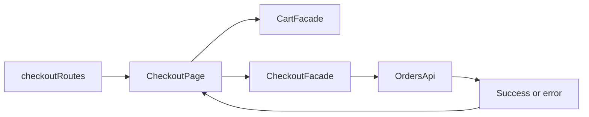

# Storefront Checkout

**Entry point:** [checkoutRoutes](../../../../libs/storefront/feature/checkout/src/lib/lib.routes.ts) opens `/checkout`.

- [CheckoutPage](../../../../libs/storefront/feature/checkout/src/lib/page/checkout-page.ts) reads [CartFacade](../../../../libs/storefront/data-access/src/lib/cart/state/cart.facade.ts), manages the contact form, and handles success/error states.
- [CheckoutFacade](../../../../libs/storefront/data-access/src/lib/checkout/state/checkout.facade.ts) builds the command and calls [OrdersApi](../../../../libs/storefront/data-access/src/lib/checkout/api/orders.api.ts). Success clears the cart; server errors are attached to the form. [Quick order contract](../../../contracts/catalog/quick-order.md).

## Architecture



## Code structure

Actual entry points and primary feature files (other files in these directories are omitted):

```text
libs/storefront/data-access/
└── src/lib/
    ├── cart/state/cart.facade.ts  # state and data interaction
    └── checkout/
        ├── api/orders.api.ts  # API request
        └── state/checkout.facade.ts  # state and data interaction

libs/storefront/feature/checkout/
└── src/lib/
    ├── page/checkout-page.ts  # page and UI composition
    └── lib.routes.ts  # feature routes
```

## Tests

Spec files sit next to the code in each project. Focused runs:

- `libs/storefront/data-access` (3 spec files): `npx nx run storefront-data-access:vite:test -- --run`

Without tests: `checkout`.
