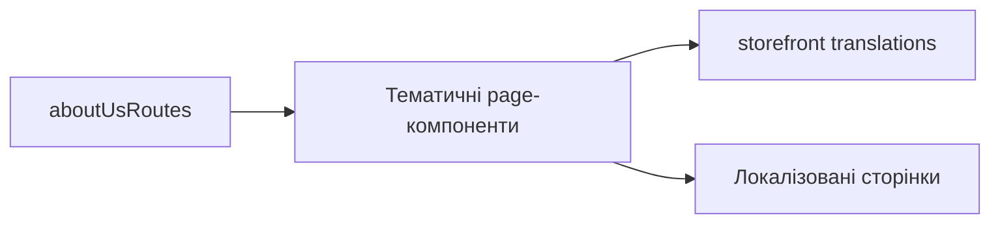

# Інформаційні сторінки Storefront

**Вхід:** [aboutUsRoutes](../../../../libs/storefront/feature/about-us/src/lib/lib.routes.ts) містить `/about-company`, `/delivery-and-payment`, `/galleria`, `/returns-exchanges`, `/requisites`, `/privacy-policy`, `/public-offer`.

- Кожен маршрут ліниво завантажує свій компонент із [feature/about-us](../../../../libs/storefront/feature/about-us/src/index.ts); сторінки розділено за темою, щоб змінювати контент локально.
- Тексти й підписи локалізуються через [storefront translations](../../../../apps/storefront/src/app/localization/translations/uk.translation.ts). Це контентні сторінки, а не API-driven операції.

## Схема будови



## Структура в коді

Фактичні точки входу й основні файли фічі (інші файли цих каталогів тут не перелічено):

```text
apps/storefront/src/app/
└── localization/translations/uk.translation.ts  # локалізований текст

libs/storefront/feature/about-us/
└── src/
    ├── lib/
    │   ├── pages/  # тематичні сторінки; кожна має власні .ts, .html і .css
    │   │   ├── about-company/about-company.ts
    │   │   ├── delivery-and-payment/delivery-and-payment.ts
    │   │   ├── galleria/galleria.ts
    │   │   ├── privacy-policy/privacy-policy.ts
    │   │   ├── public-offer/public-offer.ts
    │   │   ├── requisites/requisites.ts
    │   │   └── returns-exchanges/returns-exchanges.ts
    │   ├── sections/  # спільні секції сторінок цієї фічі
    │   └── lib.routes.ts  # маршрути фічі
    └── index.ts  # публічний API бібліотеки
```
