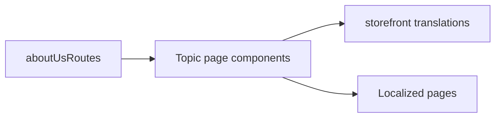

# Storefront Information Pages

**Entry point:** [aboutUsRoutes](../../../../libs/storefront/feature/about-us/src/lib/lib.routes.ts) contains `/about-company`, `/delivery-and-payment`, `/galleria`, `/returns-exchanges`, `/requisites`, `/privacy-policy`, and `/public-offer`.

- Each route lazy-loads its component from [feature/about-us](../../../../libs/storefront/feature/about-us/src/index.ts); pages are separated by topic so content can be changed locally.
- Text and labels are localized through [storefront translations](../../../../apps/storefront/src/app/localization/translations/uk.translation.ts). These are content pages, not API-driven operations.

## Architecture



## Code structure

Actual entry points and primary feature files (other files in these directories are omitted):

```text
apps/storefront/src/app/
└── localization/translations/uk.translation.ts  # localized text

libs/storefront/feature/about-us/
└── src/
    ├── lib/
    │   ├── pages/  # topic pages; each has its own .ts, .html, and .css
    │   │   ├── about-company/about-company.ts
    │   │   ├── delivery-and-payment/delivery-and-payment.ts
    │   │   ├── galleria/galleria.ts
    │   │   ├── privacy-policy/privacy-policy.ts
    │   │   ├── public-offer/public-offer.ts
    │   │   ├── requisites/requisites.ts
    │   │   └── returns-exchanges/returns-exchanges.ts
    │   ├── sections/  # shared sections for this feature's pages
    │   └── lib.routes.ts  # feature routes
    └── index.ts  # library public API
```
